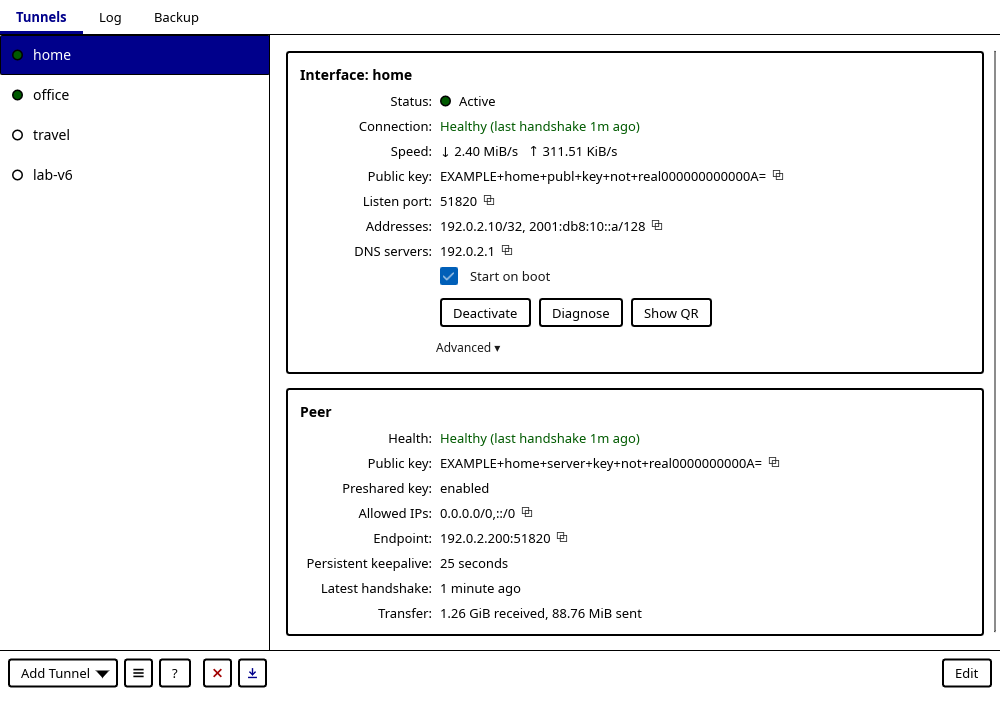
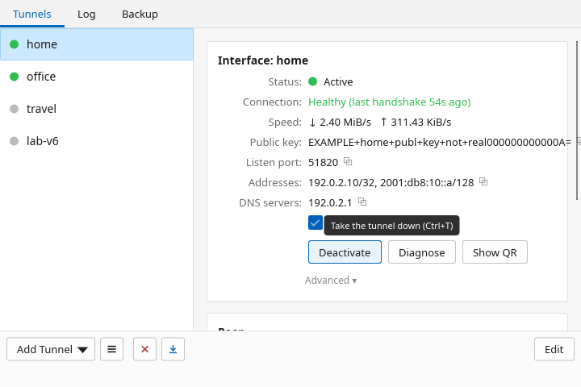

# ♿ Accessibility

This statement covers the Linux desktop application. We want it to be
comfortable for everyone, so accessibility reports and contributions are very
welcome. 💛

## ✅ Current support and limitations

- **Runs where you do.** The GUI runs in a graphical Linux session using X11 or
  Wayland, subject to the runtime requirements in the
  [distro guide](docs/DISTROS.md).
- **Keyboard all the way.** Every button, tab, list row, toggle, copy control
  and text field takes keyboard focus with Tab / Shift+Tab, shows a visible
  focus ring, and is pressed with Enter or Space. Arrow keys move through the
  tunnel and backup lists, PageUp/PageDown scroll long views, and Escape closes
  dialogs. Tabbing through a scrolled form or detail pane scrolls the focused
  control into view. Shortcuts for the main actions are listed in the in-app
  Help (F1) and in [docs/help.md](docs/help.md#keyboard-themes-and-logging).
- **Roles and names.** Interactive elements carry accessible roles and names
  (buttons, tabs, list items, groups, text fields); icon and symbol buttons have
  text names. Tests check these semantics and the keyboard paths on a headless
  backend, but operation with a screen reader has not been verified. The
  project does not claim conformance with an accessibility standard.
- **Themes.** `--theme high-contrast` (or `WG_GUI_THEME=high-contrast`) switches
  to black text, stronger borders and wider focus rings; `--theme ascii`
  replaces symbol glyphs (copy, disclosure arrows, ellipses, arrows) with
  plain-text labels. Combine them as `high-contrast+ascii`. The app has no zoom
  or font-size setting of its own; use the desktop's scaling settings.
- **Small windows.** The main window has a minimum size of 720 × 480 logical
  pixels and narrows its tunnel list below 860 pixels; the editor's minimum is
  520 × 520. Tests check that controls stay inside the window without
  overlapping at these sizes.
- **Not just colour.** Tunnel details show text such as **Active** and
  **Inactive** alongside color, and connection health is spelled out (Healthy,
  Idle, Connection failed, …). The tunnel list also uses colored status dots
  with a text name for assistive technology. Status messages stay longer when
  they are longer, but still disappear; failures that need action also appear
  as banners that stay.
- **Copy it out.** Help and diagnostic dialogs offer **Copy all**. Logs can be
  copied or saved for reading in another application. Check copied output for
  secrets before sharing it.

| 🌗 High contrast | 🪟 720 × 480 |
|:---:|:---:|
|  |  |

Prefer a keyboard-oriented interface? See
[wireguard-tui](https://github.com/JamilleJung/wireguard-tui) and its
[accessibility notes](https://github.com/JamilleJung/wireguard-tui/blob/main/ACCESSIBILITY.md).
It has its own limitations.

## 📣 Report a barrier

Open a [bug report](https://github.com/JamilleJung/wireguard-gui/issues/new?template=bug_report.yml)
and describe the affected control or task, what you expected, and what happened.
Include the app version, distribution, desktop/session, and any assistive
technology or input method involved. A redacted screenshot or short recording
can help, but is optional.

> [!CAUTION]
> Please don't post private keys, preshared keys, tunnel configs, QR codes or
> backup archives. If the report contains personal information, email
> [izeystudio@gmail.com](mailto:izeystudio@gmail.com) instead. Report security
> vulnerabilities using [SECURITY.md](SECURITY.md).
