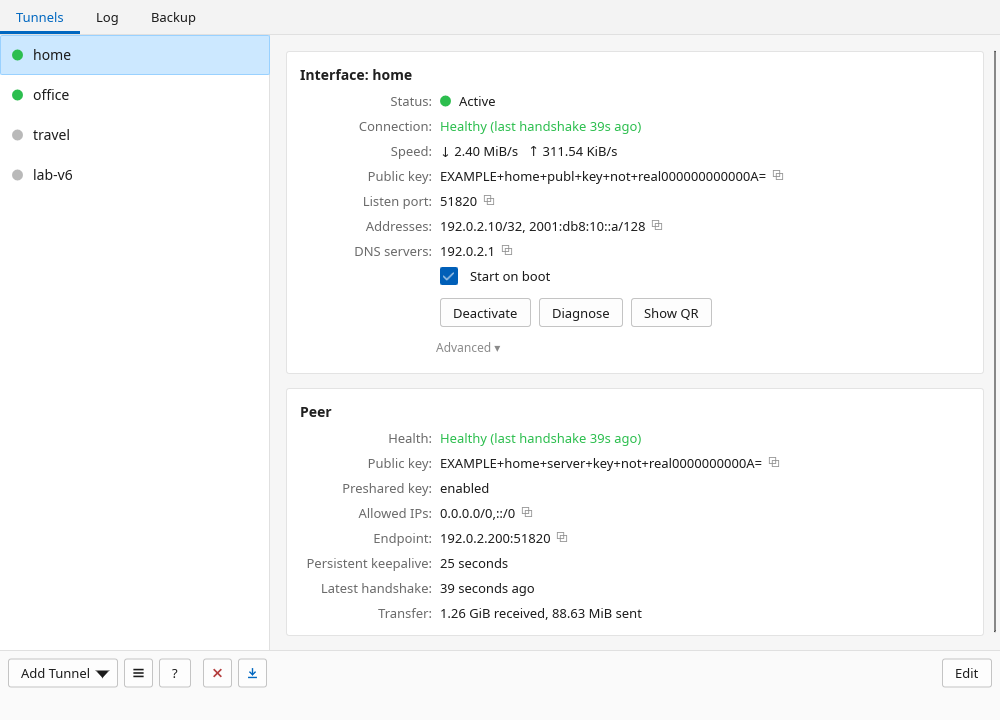
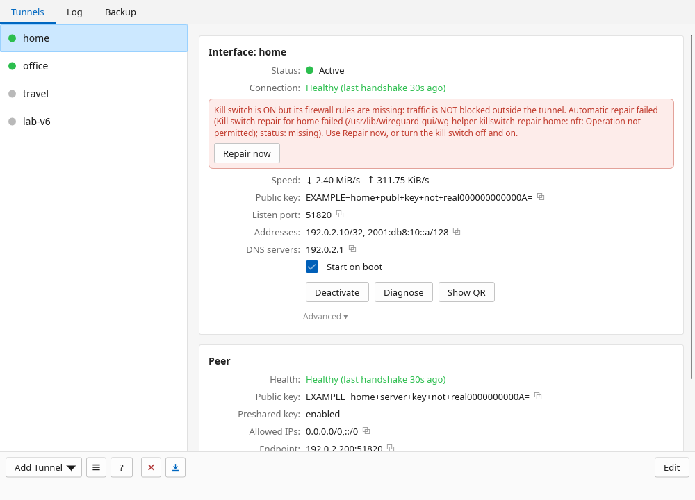
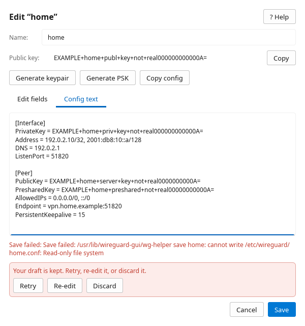
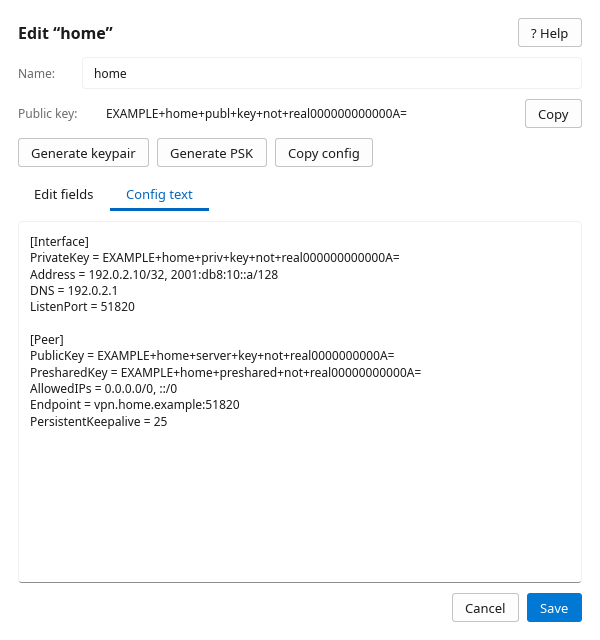
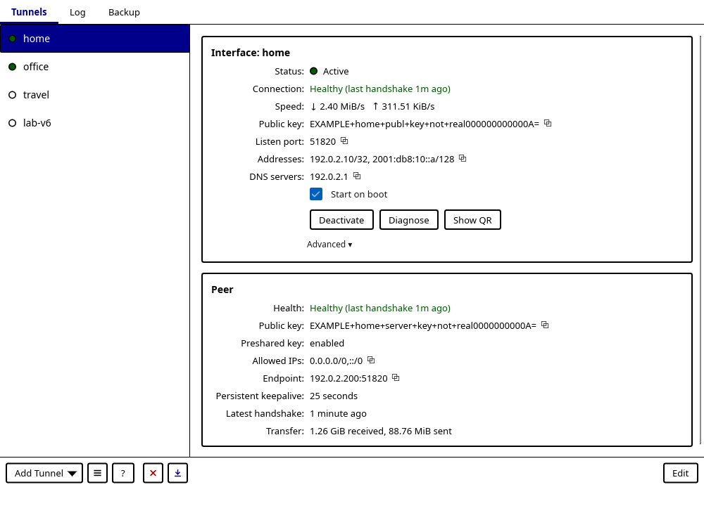
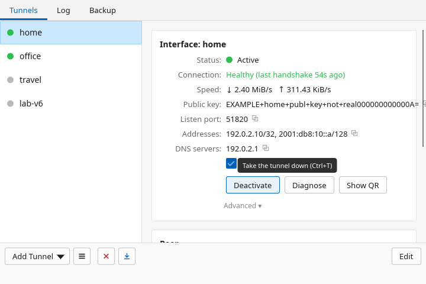
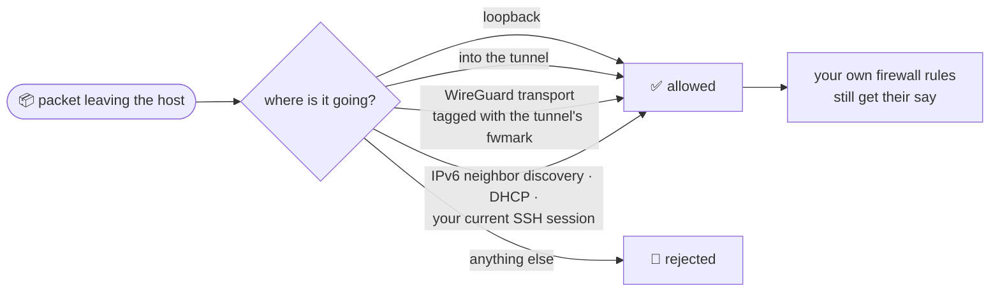
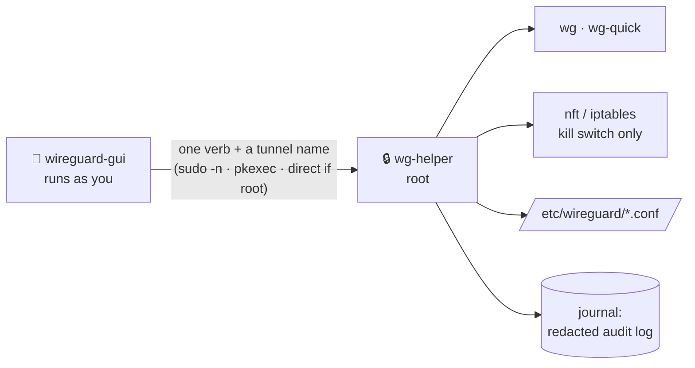

<div align="center">


# 🐉 wireguard-gui

### A WireGuard client that feels at home on the Linux desktop.

Tunnel list on the left, live Interface and Peer cards on the right, one click
to connect. Plain `/etc/wireguard/*.conf` files, `wg` and `wg-quick` underneath,
and every root operation behind one small, auditable Rust helper.

[](https://github.com/JamilleJung/wireguard-gui/actions/workflows/ci.yml)
[](https://github.com/JamilleJung/wireguard-gui/releases/latest)
[](LICENSE)




<sub>The real app with fictional tunnels. The keys are as fake as a three-dollar bill — please don't try them.</sub>

**[🚀 Install](#-install)** ·
**[🖼️ Tour](#️-a-quick-tour)** ·
**[🎮 Usage](#-usage)** ·
**[🛡️ Kill switch](#️-the-kill-switch-explained-like-youre-busy)** ·
**[🔐 Security](#-security-model)** ·
**[📚 Docs](#-docs)**

</div>

---

> [!TIP]
> **TL;DR** — download the `.deb` or tarball from the
> [latest release](https://github.com/JamilleJung/wireguard-gui/releases/latest),
> or `git clone https://github.com/JamilleJung/wireguard-gui && cd wireguard-gui && ./install.sh`.
> Then launch **WireGuard** from your app menu. 🔌

Live in a terminal? ⌨️ The sibling
**[wireguard-tui](https://github.com/JamilleJung/wireguard-tui)** is the same
idea as a keyboard-driven terminal UI.

## 🎉 What's new in 1.10

The "fewer surprises" release. Grab it from the
**[v1.10.0 release page](https://github.com/JamilleJung/wireguard-gui/releases/tag/v1.10.0)**.

| | What changed | Why you'll like it |
|---|---|---|
| 🛡️ | **Kill switch, rebuilt** — its own nftables table / iptables chain, IPv6 Neighbor Discovery allowed | Never fights firewalld or your rules, your deny rules always win, and IPv6 endpoints stay reachable |
| 🔁 | **Self-repairing kill switch** — a red banner, automatic repair and a **Repair now** button | A firewall reload no longer silently switches your protection off |
| ✏️ | **Live edits keep the fwmark** — `wg syncconf` can't reset it any more | Editing a connected tunnel no longer breaks routing or the kill switch |
| 🩺 | **Health per peer** — Healthy, Connecting, Idle, No traffic, Handshake stale, Connection failed | A quiet tunnel reads as *Idle*, not broken |
| 📝 | **Drafts never vanish** — Retry / Re-edit / Discard, and restore rolls back on failure | A failed save or half-finished restore can't eat your work |
| 🧪 | **QR images decoded in a sandbox child process** | A hostile image can't crash the app (found by fuzzing!) |
| ⌨️ | **Keyboard & accessibility** — every control focusable, screen-reader labels, high-contrast and ASCII themes, works down to 720×480 | Comfortable for everyone, on any screen |
| 💻 | **More machines** — glibc 2.35 builds for x86_64, i686, aarch64 and armv7 | Runs on Debian 12, Ubuntu 22.04 and newer, including 32-bit and Raspberry Pi |
| 📦 | **Installer remembers** your method and auth mode, rolls back on failure, speaks SELinux, no more `pacman -Sy` | Updates keep your setup; a failed install leaves nothing half-done |

Upgrading from 1.9.x? A kill switch built by the old version shows up as
`mismatch` once and is rebuilt automatically. Everything else just works.
The full list lives in the [changelog](CHANGELOG.md#1100---2026-11-05).

## 💡 Why does this exist?

Linux already has excellent WireGuard primitives. What it was missing was a
small, native client that makes the everyday loop *visible*: import a config,
bring the tunnel up, see whether the peer is actually talking to you, edit the
plain file, read the logs, and turn on start-at-boot. NetworkManager was the
original spark; the bigger idea is the clarity of a desktop client without
hiding what `wg` and `wg-quick` are doing.

| It is | It is not |
|---|---|
| 🦀 a native Rust + [Slint](https://slint.dev) binary | 🧱 Electron, a WebView, or a browser tab pretending to be an app |
| 📄 plain `/etc/wireguard/*.conf` files | 🗄️ a config database you can't `cat` |
| 🧰 `wg`, `wg-quick`, systemd `wg-quick@<name>` | 🕸️ a NetworkManager plugin |
| 👤 a normal user process with a tiny root helper | 👑 a GUI running as root (ever) |
| 🔍 small enough to read, easy to fork | 🎩 a VPN provider (bring your own config) |

<a id="screenshots"></a>

## 🖼️ A quick tour

| 🛡️ Kill switch self-repair | 📝 Drafts never vanish |
|:---:|:---:|
|  |  |
| A firewall reload ate the rules? It turns red, then fixes itself. | Save failed? Your edit waits: Retry / Re-edit / Discard. |
| ✏️ **Editor** | 📱 **QR for your phone** |
|  |  |
| Form fields or raw text, with validation before anything is saved. | Point the WireGuard mobile app at the screen. Done. |
| 🌗 **High contrast** | 🪟 **Small windows welcome** |
|  |  |

## ✨ What it does

**🔌 Everyday tunnels**
- One-click Activate / Deactivate; live interface and peer cards with endpoint,
  allowed IPs, handshake, transfer and throughput.
- Health per peer **and** per tunnel: 🟢 Healthy · 🔵 Connecting · ⚪ Idle ·
  🟡 No traffic · 🟠 Handshake stale · 🔴 Connection failed.
- systemd start-on-boot, a tray menu (StatusNotifier/AppIndicator), the system
  journal in a Log tab.

**📝 Configs, imports and backups**
- Import one or many `.conf` files or a PNG/JPEG QR image; a single import opens
  for review so you can name it yourself, bulk imports get unique names.
- Create from presets (Interface-only, full tunnel, split tunnel) with fresh
  keys; edit with simple multi-peer forms or raw text.
- Show a tunnel as a QR code, export all to ZIP, private backups shared with
  the terminal app.
- A draft that fails validation or saving is **kept** — Retry / Re-edit / Discard.

**🛡️ Safety nets**
- A temporary kill switch (nftables or iptables) that notices lost rules and
  repairs itself, with a **Repair now** button.
- Every action is checked against the real state afterwards; timeouts are
  re-checked, not guessed.
- Backup restore rolls back if anything fails halfway.
- Imports never hang on a FIFO, and QR images are decoded in a throwaway child
  process.

**🩹 Help when things are weird**
- A Setup window on first run when something critical is missing, with
  **Fix automatically** for the safe parts.
- **Diagnose**: clock, handshake, endpoint ping and DNS in one click.
- In-app Help (F1), changelog and verified, signed updates.

**♿ Comfortable for everyone**
- Every control reachable with Tab / Shift+Tab with a visible focus ring,
  screen-reader roles and labels, shortcuts for the main actions.
- Default, high-contrast and ASCII themes; works down to 720 × 480.

<a id="install"></a>

## 📦 Install

Grab the **[latest release](https://github.com/JamilleJung/wireguard-gui/releases/latest)**:

| Download | For | `uname -m` |
|---|---|---|
| `wireguard-gui_1.10.0-1_amd64.deb` | Debian / Ubuntu / Mint — GUI, helper, launcher, icon, polkit rule | `x86_64` |
| `wireguard-gui-1.10.0-x86_64-linux.tar.gz` | 64-bit Intel/AMD | `x86_64`, `amd64` |
| `wireguard-gui-1.10.0-i686-linux.tar.gz` | 32-bit Intel/AMD | `i386`…`i686` |
| `wireguard-gui-1.10.0-aarch64-linux.tar.gz` | 64-bit ARM (Raspberry Pi 4/5, ARM laptops) | `aarch64`, `arm64` |
| `wireguard-gui-1.10.0-armv7-linux.tar.gz` | 32-bit ARMv7 hard-float | `armv7l`, 32-bit `armv8l` |
| `wireguard-gui-1.10.0-x86_64.AppImage` | Any x86_64 distro (attached when its optional build succeeds) | `x86_64` |
| `SHA256SUMS`, `SHA256SUMS.minisig`, `minisign.pub` | checksums, signature, key | — |

> [!NOTE]
> Release binaries need **glibc 2.35 or newer**: Debian 12, Ubuntu 22.04,
> Fedora and anything newer. Not RHEL 9 (glibc 2.34), and not musl distros like
> Alpine — build from source there. The release refuses to publish a binary that
> needs a newer glibc. 1.9.3 and older were built against glibc 2.39.

<a id="verify-a-download"></a>

### ✅ Verify first (it takes ten seconds)

```sh
asset=wireguard-gui-1.10.0-x86_64-linux.tar.gz
minisign -Vm SHA256SUMS -P RWSrokrj4nWGDhUf409+6yXuqPfF7WQuGtSk/PdsnTWKwfOpb3Hv4DxG
awk -v file="$asset" '$2 == file { print; n++ } END { if (n != 1) exit 1 }' SHA256SUMS > selected.sha256 &&
sha256sum --check --strict selected.sha256
```

> [!IMPORTANT]
> Both checks must pass. A key downloaded next to the artifact is not a trust
> anchor — compare it with [`minisign.pub`](minisign.pub) in this repo or use the
> key above. Releases are never published unsigned.

### 🐧 Debian-family package

```sh
sudo apt install ./wireguard-gui_1.10.0-1_amd64.deb
wireguard-gui
```

The package installs under `/usr` but **does not create the `wireguard` group**.
For passwordless polkit access from your desktop session, an administrator adds
you once:

```sh
sudo groupadd -f wireguard
sudo usermod -aG wireguard "$USER"   # then log out and back in
```

Group members can manage every tunnel and read its keys, so only add people you
trust. Without the rule matching, `pkexec` may ask for an administrator password
or be refused by local policy.

### 📦 Prebuilt tarball

```sh
tar -xzf wireguard-gui-1.10.0-x86_64-linux.tar.gz
cd wireguard-gui-1.10.0-x86_64-linux
./install.sh          # as your normal user
```

The installer spots the prebuilt binaries, skips Rust and the compiler, installs
runtime packages and helper authorization, and refuses a bundle built for a
different CPU. You *can* run the extracted app straight away to look around, but
a user-owned helper is not trusted for root work — install it first. AppImage
users need an installed helper too.

### 🛠️ Build from source

```sh
git clone https://github.com/JamilleJung/wireguard-gui.git
cd wireguard-gui
./install.sh
```

That's it. The installer:

1. 🔎 detects `apt-get`, `dnf`/`yum`, `pacman`, `zypper`, `apk`, `xbps-install` or `eopkg`;
2. 📦 installs only what's missing — the C toolchain, `pkg-config`, the libraries
   Slint needs, an OpenGL runtime and `wireguard-tools` — plus Rust via rustup;
3. 🦀 builds as you, then installs the app, helper, launcher and icon under `/usr/local`;
4. 🔑 sets up helper authorization (a scoped sudoers grant by default);
5. 🧾 records what it did, so re-runs and updates keep your choices.

```sh
./install.sh                 # default: per-user sudoers grant for the helper
./install.sh --polkit        # group-restricted polkit rule instead
./install.sh --binaries=DIR  # install prebuilt binaries from DIR
./install.sh --force         # install even though a distribution package copy exists
./install.sh uninstall       # remove everything it added (your tunnels stay)
```

The script also creates a `wg-gui` alias (Cargo builds and distro recipes
don't). See the [distro notes](docs/DISTROS.md) and
[packaging details](packaging/PACKAGING.md).

<details>
<summary>🧾 What the installer promises (the fine print, all of it true)</summary>

- **It remembers.** A root-owned `PREFIX/lib/wireguard-gui/install-manifest`
  records the method, prefix and authorization mode; a re-run, `--update` or the
  in-app updater keeps them unless a flag changes them.
- **It undoes itself.** A failed or interrupted install restores the previous
  binaries, authorization files and `wireguard` group setup.
- **It won't double up.** With a distribution package present it refuses a
  second copy under `/usr/local` (use the package manager, or `--force`); the
  in-app updater refuses to replace a package or `cargo install` copy and names
  the right command.
- **It is nice to Arch.** Only missing packages, via `pacman -S --needed`, no
  database refresh (no partial upgrades). Run `sudo pacman -Syu` first if that
  fails.
- **It speaks SELinux.** With SELinux enforcing it labels the helper `bin_t`,
  restores file contexts and checks that the helper actually runs.
- **It validates everything.** Unknown options fail; switching sudoers/polkit
  installs and validates the new grant before removing the old one; failed
  validation or group enrollment keeps the previous authorization. `--polkit`
  requires pkexec up front and reuses an existing `wireguard` group and
  membership (Alpine/BusyBox included).
- **Root and `PREFIX`.** A direct root login needs `--allow-root` (or
  `WG_ALLOW_ROOT=1`). `PREFIX` must be an absolute ASCII path of letters, digits,
  `/`, `_`, `.` and `-` without empty, `.`, `..` components or a trailing slash,
  whose existing ancestors are root-owned and not group/other writable
  (symlinks refused) — so a group-writable `/usr/local` fails. `--polkit`
  supports only `/usr` or `/usr/local`.

</details>

## 🎮 Usage

```sh
wireguard-gui                          # launch (a second launch raises the window)
wireguard-gui --theme high-contrast    # default · high-contrast · ascii · high-contrast+ascii
wireguard-gui --version | --help       # no window
```

`WG_GUI_THEME=NAME` picks the theme too, and `WG_GUI_LOG=/path/file` writes a
redacted, structured debug log (created `0600`). There are no command-line
tunnel subcommands; an unknown first argument exits `2`.

- **Tunnels** — select one, then **Activate** / **Deactivate**, **Diagnose**,
  **Show QR**, **Start on boot** or **Edit**. The bottom bar has **Add Tunnel**,
  delete and export-all; the menu has **Help…**, **Check for updates…** and
  **About…**.
- **Advanced ▾** on the tunnel card reveals **Kill switch**, **Running cfg** and
  **Save live** (the expansion is remembered).
- **Editor** — Interface and Peer fields with peer add/remove, key and PSK
  generation and copy buttons; **Advanced fields** adds Listen port and MTU.
  **Create**, **Create & Activate** or **Save**; changing Name renames.
- **Log** — refresh, filter, **This tunnel**, save, clear the view, copy.
- **Backup** — **New backup**, then restore, export or delete.

| ⌨️ Shortcut | Does |
|---|---|
| `Ctrl+1` / `Ctrl+2` / `Ctrl+3` | Tunnels / Log / Backup tab |
| `Ctrl+O` · `Ctrl+I` · `Ctrl+N` | Import file(s) · import QR · create tunnel |
| `Ctrl+E` · `Ctrl+T` · `Ctrl+D` | Edit · activate/deactivate · diagnose |
| `Ctrl+R` / `F5` | Refresh |
| `Ctrl+S` | Export all (Tunnels) / save log (Log) / save (editor) |
| `F1` · `Ctrl+U` | Help · check for updates |
| `Tab` / `Shift+Tab` · `Enter` / `Space` · `Esc` | Move focus · press · close |

Edits to an active tunnel are applied live with `wg syncconf`; Address, DNS,
MTU, Table and route changes still need a reconnect. Renaming stops the old
interface (keeping its start-on-boot setting) and doesn't start the new name for
you.

## 🛡️ The kill switch, explained like you're busy

Turn it on from **Advanced ▾ → Kill switch** on a connected tunnel. From then
on, anything trying to leave your machine **outside** the tunnel gets politely
rejected:



| Status | Meaning | What the app does |
|---|---|---|
| 🟢 `enabled` | Complete rules whose mark matches the running tunnel | Nothing. Enjoy your coffee. |
| ⚪ `disabled` | Off | Nothing. |
| 🟠 `missing` | It was on, but the rules vanished (hello, `firewall-cmd --reload`) | Red banner, automatic repair (once, then after 15 s and 90 s), **Repair now** |
| 🟡 `mismatch` | Rules exist but are stale (mark changed, tunnel down, built by an older release) | Same, on an active tunnel |

<details>
<summary>🔬 The nerdy details (nftables, iptables, fwmarks, IPv6)</summary>

- **Its own table, nobody else's.** With nftables the switch lives in a
  dedicated `inet wg_helper_killswitch` table with its own OUTPUT base chain,
  replaced in one nft transaction. It never edits another table, so firewalld,
  a distro ruleset or your own rules stay untouched.
- **iptables fallback.** A dedicated `WGH-KILLSWITCH` chain reached by one jump
  at the top of `OUTPUT`. Needs `iptables` + `iptables-restore`, and
  `ip6tables` + `ip6tables-restore` whenever the kernel has IPv6. Both families
  are preflighted; commits are atomic per family.
- **Your deny rules always win.** nftables `accept` only ends the kill switch's
  own chain, and the iptables chain `RETURN`s allowed traffic instead of
  accepting it. The iptables jump must stay first in `OUTPUT`; if another rule
  gets in front of it, the switch counts as incomplete (`missing`) and is
  rebuilt.
- **Allowed:** loopback; packets routed into the tunnel; WireGuard's transport
  (the tunnel's runtime fwmark); IPv6 router/neighbor solicitation and neighbor
  advertisement (hop limit 255) and MLDv2 reports — without them an IPv6
  endpoint goes dark once its neighbor-cache entry expires; DHCP client traffic;
  established SSH return traffic when `SSH_CONNECTION` reaches the helper.
- **Live edits are safe.** `wg syncconf` would silently reset the fwmark
  wg-quick set at runtime. The helper carries the running fwmark and listen
  port into the synced config, refuses a config that changes `FwMark` on a
  running tunnel (reconnect instead), re-reads the mark and repairs the switch.
- **One at a time, fail closed.** Only one tunnel can own the switch; it needs
  an active interface and can assign an unused runtime fwmark without touching
  the saved file. Down/delete/rename keep protection while the interface is up
  or unknown; if the interface disappears without a disconnect the rules keep
  blocking (`mismatch`) until you disconnect. Quitting doesn't clear the rules.
- **Not persistent.** Rules and the "it was requested" marker live in the
  kernel and under `/run`, so both are gone after a reboot. A switch built by
  1.9.3 or older reports `mismatch` and is rebuilt in the new layout.
- Host-output control only — not forwarding/NAT for a server, not a general
  no-leak guarantee — and it can interrupt remote access.

Proven against real kernels in CI: `tests/killswitch-e2e.sh` builds real
WireGuard tunnels in network namespaces (IPv4 and IPv6 endpoints × nftables and
iptables) and checks leaks, neighbor-cache expiry, deny-rule precedence, live
updates, firewall reloads and interface loss.

</details>

**Start on boot** toggles the systemd `wg-quick@<name>` service: it changes
what happens at the next boot, not desktop login or the current state. Other
init systems need their own service.

## 🩺 Is my tunnel actually OK?

WireGuard is a polite protocol: it only talks when it has something to say.
So an old handshake on a quiet tunnel isn't a funeral, it's a nap. 😴

| Health | Means |
|---|---|
| 🟢 **Healthy** | A handshake within the last 3 minutes |
| 🔵 **Connecting** | Traffic is moving and a (new) handshake is on its way |
| ⚪ **Idle** | Nothing to send right now, so no fresh handshake. Totally normal. |
| 🟡 **No traffic** | Nothing has been sent or received since you connected |
| 🟠 **Handshake stale** | Keepalive is on, so the handshake should have been renewed — and wasn't |
| 🔴 **Connection failed** | Sending for 90+ seconds with no answer, or a keepalive peer that never answered |

A warning banner appears only for the last two. The system clock is named as a
*possible* cause only when handshakes are really failing and the clock isn't
synced.

## ✏️ Editing, backups and imports

- Configs stay plain text: comments, repeated directives, routing directives and
  unknown fields survive in raw text. The helper refuses `PreUp`/`PostUp`/
  `PreDown`/`PostDown` — they would run as root.
- Backups live in `$XDG_DATA_HOME/wireguard/backups` (or
  `~/.local/share/wireguard/backups`), shared with the terminal app. **They
  contain unencrypted private keys.** So do QR codes, exports and running
  config.

<details>
<summary>📏 Limits, rollbacks, validation and responsiveness</summary>

- **Imports** must be regular files ≤ 1 MiB (QR images ≤ 32 MiB); FIFOs and
  other special files are refused without waiting. QR images are decoded in a
  short-lived child process with a memory limit and a deadline, so a hostile
  image can only fail its own import.
- **Validation** is shared by the app and the helper: every directive, known
  sections and placement, canonical 32-byte base64 keys (padding bits too),
  CIDR/port/keepalive bounds and required peer fields. Supported: inline
  comments, repeated Interface sections and Address/DNS/AllowedIPs, scoped IPv6
  endpoints, named/numeric Table, FwMark hex/off, SaveConfig booleans. A present
  `PresharedKey` must be valid; unknown fields stay visible but can't be saved
  until fixed.
- **Responsiveness.** Heavy tunnel, editor, import, QR, export and backup work
  runs off the UI thread; a shared busy guard rejects conflicting operations,
  and stale results never replace a newer selection or draft. Local dialogs,
  file writes and clipboard work can still briefly block.
- **Backup directories** must belong to you and are tightened to `0700`
  (symlink directories refused); ZIPs and exports are `0600`, uniquely named,
  never overwriting another archive.
- **Export** reads every tunnel or reports an error — never a "successful"
  partial archive — and publishes atomically (old file kept on failure, final
  symlinks refused, other hardlink names untouched).
- **Restore** accepts only valid, unique, top-level `.conf` entries and rejects
  bad names, invalid configs and hooks before the first save. Limits: 64 MiB per
  ZIP, 4,096 entries, 1,024 configs, 1 MiB per config, 16 MiB total; backup
  files must be owned regular files with one link. Restore copies every config
  it will overwrite, saves one by one, and if a save fails or times out it
  **rolls back** and reports every tunnel it restored, removed, or — if a
  rollback step failed — left changed. It doesn't sync running interfaces. The
  helper's own per-save copies are under `/etc/wireguard/.backup/`.

</details>

## 🩹 Setup, diagnostics and updates

- **Setup** opens at startup when something critical is missing: tools, the
  helper and its authorization, `/etc/wireguard`, DNS integration, clock sync,
  systemd and journald. **Show commands**, **Re-check**, **Skip for now**, or
  **Fix automatically** (installs WireGuard tools or a DNS provider, enables an
  inactive systemd-resolved behind its shim, creates `/etc/wireguard` — read the
  commands first). It never installs the helper, creates tunnels or connects
  them.
- **Diagnose** checks clock sync, interface and handshake state, endpoint ping
  and DNS. Treat the results as hints: blocked ICMP alone doesn't mean a server
  is down.
- **Updates.** Startup and manual checks ask GitHub (via `curl`). **Update now**
  downloads the tarball for your CPU, checks it with the compiled-in minisign key
  and its exact signed checksum, then runs the verified installer with your
  recorded prefix and authorization mode. Package-manager installs are left to
  the package manager. It needs `curl`, `tar`, `sha256sum`, `minisign` and
  normally `pkexec`; restart the app afterwards. Opt out of the startup check
  with `WG_NO_UPDATE_CHECK=1` or
  `${XDG_CONFIG_HOME:-$HOME/.config}/wireguard-gui/no-update`.

## 🔐 Security model



- The GUI is a normal user process. The helper accepts **only** a fixed set of
  verbs and validated tunnel names — no paths, no options, no shell — runs tools
  from fixed paths with an empty environment, writes configs `0600` through a
  synced temp file and rename, and logs every change with secrets redacted.
- A passwordless grant controls every tunnel and can read every key; it is not
  isolation between users. Configs an administrator puts in `/etc/wireguard` by
  hand remain the administrator's responsibility — activating one runs
  `wg-quick` normally.

<details>
<summary>🧐 Audited helper and update behaviour</summary>

- **Which helper?** Release builds only use this project's own
  `/usr/local/lib/` or `/usr/lib/` helper, or an adjacent **trusted** one:
  root-owned, executable, not group/other writable, with trusted parent
  directories. Release builds never fall back to the build tree or the other
  app's helper; debug overrides exist for development only.
- **No password-dialog storms.** Background read-only requests ask polkit
  non-interactively first, so missing authorization becomes an actionable error.
- **Bounded IPC.** Input and output are drained concurrently, capped at 4 MiB
  per stream, with an overall 90-second deadline (10 seconds for local key
  generation). After a timeout the app re-reads the real state instead of
  guessing.
- **Updates.** The private download directory is owned and cleaned up on every
  path; the whole bundle is checked before escalation (regular single-link
  files, no symlink components, a fresh exclusive staging tree); HTTPS-only
  redirects; the verified version must be newer than the running one; the build
  for your CPU (x86_64/i686/aarch64/armv7) is picked, anything else fails
  explicitly.

</details>

Full details and threat model: **[SECURITY.md](SECURITY.md)** · architecture and
data flow: **[docs/ARCHITECTURE.md](docs/ARCHITECTURE.md)**.

## 🐛 Troubleshooting

<details>
<summary><b>"It says Idle. Is my VPN dead?"</b></summary>

Nope, it's napping. WireGuard only handshakes when there's traffic. Open a page
or ping a peer and watch it turn 🟢. If it goes 🟠 or 🔴 instead, hit
**Diagnose**.
</details>

<details>
<summary><b>"Active", but <code>0 B received</code> and no handshake — ever</b> 🕰️🛸</summary>

Before you blame the server, check whether your PC has become a time traveller.
WireGuard stamps every handshake with the current time. If your clock once
leapt into the future (hello, dual-boot Windows and dying CMOS batteries), the
server remembers that future timestamp and — thanks to its replay protection —
politely ignores every *correctly timed* handshake you send afterwards. Your
packets cheerfully leave the building; the server just refuses to talk to
someone who keeps trying to "replay" tomorrow.

Fix: sync the clock (`timedatectl set-ntp true`, or install chrony), and if it
already drifted, reset the peer on the server (on wg-easy:
`docker restart wg-easy`). **Diagnose** points at the clock — but only when
handshakes are really failing *and* the clock isn't synced, because an idle
tunnel with an old handshake is just napping. This check was lovingly forged
during one very long evening of staring at `0 B received` and slowly losing our
minds.
</details>

<details>
<summary><b>Activating fails with <code>resolvconf: command not found</code></b></summary>

`DNS =` needs a working `resolvconf`: install `openresolv`, or use
systemd-resolved (if yours is the `resolvectl` shim, the service must be
running). The Setup window can fix both; per-distro notes in
[docs/DISTROS.md](docs/DISTROS.md).
</details>

<details>
<summary><b>It asks for a password every time</b></summary>

Run `./install.sh` (sudoers) or `./install.sh --polkit` so the installed helper
is authorized, then log out and back in. With polkit you need an active local
session **and** membership in `wireguard`.
</details>

<details>
<summary><b>No tray icon</b></summary>

Your desktop needs a StatusNotifier/AppIndicator host — GNOME usually needs the
AppIndicator extension. Without a tray, closing the window quits; with one, use
the tray's **Quit**.
</details>

<details>
<summary><b>Blank window or invisible inputs</b></summary>

Check the OpenGL/EGL and Slint runtime libraries (the installer and `.deb`
pull them in). On proprietary NVIDIA + Wayland with `DISPLAY` available the app
prefers XWayland; set `WG_FORCE_WAYLAND=1` to opt out.
</details>

<details>
<summary><b>Empty Log tab, or no Start on boot</b></summary>

The Log tab needs `journalctl`, start-on-boot needs systemd. And please don't
let NetworkManager and this app drive the same interface at once — two
captains, one boat.
</details>

## 🔧 Hacking on it

This is MIT open source — fork it and hack on your own ideas.

```sh
cargo run --release --locked            # run from source
bash scripts/dev-setup.sh               # checks your machine has everything the checks need
cargo fmt --all -- --check && cargo clippy --all-targets --locked -- -D warnings && cargo test --locked
```

### 🗺️ Codebase map

| Path | What lives there |
|---|---|
| `ui/*.slint` | The interface: theme, widgets, main window, editor, dialogs |
| `src/main.rs`, `src/state.rs`, `src/events.rs` | Startup, shared state, UI callbacks |
| `src/actions.rs`, `src/ops.rs`, `src/live.rs` | Background operations, the operation state machine, live refresh and kill switch repair |
| `src/draft.rs`, `src/ui_bridge/` | Editor drafts and Rust ↔ Slint models |
| `src/backend/` | Helper client, typed errors, status, verification, backups, QR, health, diagnostics |
| `src/import_parse.rs`, `src/qr_isolate.rs`, `src/safe_file.rs` | Import parsing, isolated QR decoding, the one safe file-open routine |
| `src/config.rs`, `src/secrets.rs` | Config parsing/validation and secret redaction (compiled into the helper too) |
| `src/validation.rs` | Tunnel-name rules and import-name sanitising (property-tested against the helper's own check) |
| `src/theme.rs`, `src/layout.rs`, `src/tray.rs` | Themes, window-size breakpoints, tray |
| `src/doctor.rs`, `src/update.rs` | Setup checks and the verified updater |
| `src/bin/wg-helper/` | The privileged helper: verbs, filesystem, runtime, firewall (`nft.rs`, `iptables.rs`), logging |
| `install.sh`, `packaging/` | Installer, polkit rule, desktop entry, distro recipes |
| `tests/`, `fuzz/` | Shell suites, property tests, fixtures, fuzz targets |

### 🔒 Adding privileged behaviour

Add a helper verb only when it maps to a concrete WireGuard operation. Keep the
input shape fixed, validate tunnel names before touching the filesystem, use
fixed paths, never go through a shell, back up before destructive changes,
check the resulting state, and never log private keys.

More in [CONTRIBUTING.md](CONTRIBUTING.md): the full check list (property tests,
fuzzing, mutation testing, namespace and end-to-end tests) and helper override
rules.

## 🚧 Known limitations

- Start-on-boot is systemd-only; the tray needs StatusNotifier/AppIndicator.
- The kill switch is temporary host-output policy, not a daemon or persistent
  firewall manager, and only one tunnel can own it at a time.
- The structured editor covers the common Interface/Peer fields; configs with
  `Table`, `SaveConfig` or unknown directives stay in raw text.
- The `.deb` and AppImage are x86_64 only; other CPUs use the tarballs. Release
  binaries need glibc 2.35+.
- WireGuard tools and kernel modules are not bundled.

## 🗺️ Roadmap

- Get the AUR, Fedora, Alpine and Void packages into their official repositories.
- Your idea here — [open an issue](https://github.com/JamilleJung/wireguard-gui/issues).

## 📚 Docs

| | |
|---|---|
| 🧭 [Tutorial](docs/TUTORIAL.md) | From zero to a connected tunnel, step by step |
| 📖 [WireGuard concepts](docs/help.md) | Keys, peers, AllowedIPs, handshakes — the in-app Help |
| 🐧 [Distros and DNS](docs/DISTROS.md) | Per-distro notes, resolvers, SELinux |
| 🏗️ [Architecture](docs/ARCHITECTURE.md) | Privilege boundary, modules, data flow, kill switch design |
| 🔐 [Security](SECURITY.md) | Threat model, helper verbs, limits |
| 📦 [Releases](docs/RELEASES.md) · [Packaging](packaging/PACKAGING.md) | Verification, pipeline, distro recipes |
| ✅ [Release checklist](docs/RELEASE_CHECKLIST.md) · [Repo settings](docs/REPO_SETTINGS.md) | For maintainers |
| ♿ [Accessibility](ACCESSIBILITY.md) · 🤝 [Contributing](CONTRIBUTING.md) | Themes, keyboard, how to help |
| 📋 [Changelog](CHANGELOG.md) | What changed, and when |

## ⭐ Star this project

If `wireguard-gui` is useful to you, **please give it a star on GitHub** ⭐ — it
genuinely helps other people discover the project and keeps the work going.

👉 **[Star wireguard-gui on GitHub](https://github.com/JamilleJung/wireguard-gui)**

You can also **watch** the repo for releases and **fork** it to hack on your own ideas.

## ☕ Buy me a coffee

This is a free, open-source project built in spare time. If it saved you some
trouble and you'd like to say thanks, a coffee is hugely appreciated 💛

<div align="center">

[](https://www.buymeacoffee.com/jamillejung)

**[☕ buymeacoffee.com/jamillejung](https://www.buymeacoffee.com/jamillejung)**

</div>

## 📄 License

MIT. WireGuard is a registered trademark of Jason A. Donenfeld. This is an
independent, unofficial client and is not affiliated with or endorsed by the
WireGuard project.
