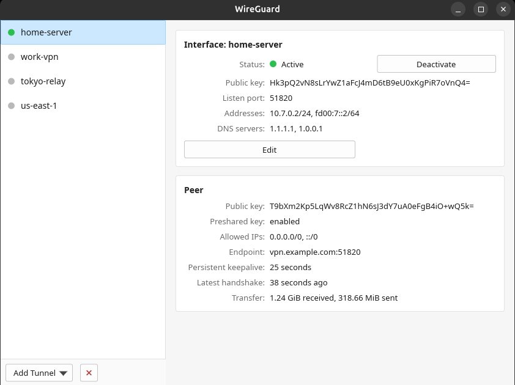
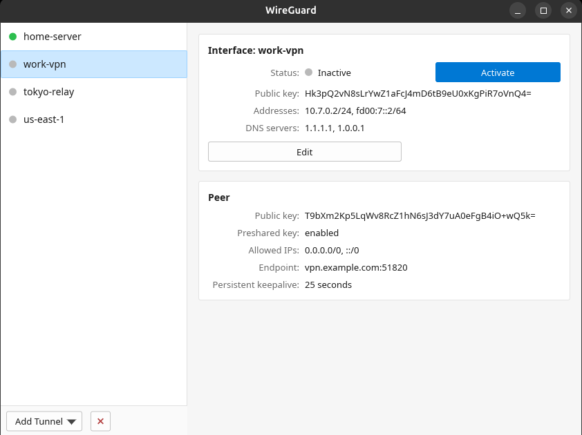
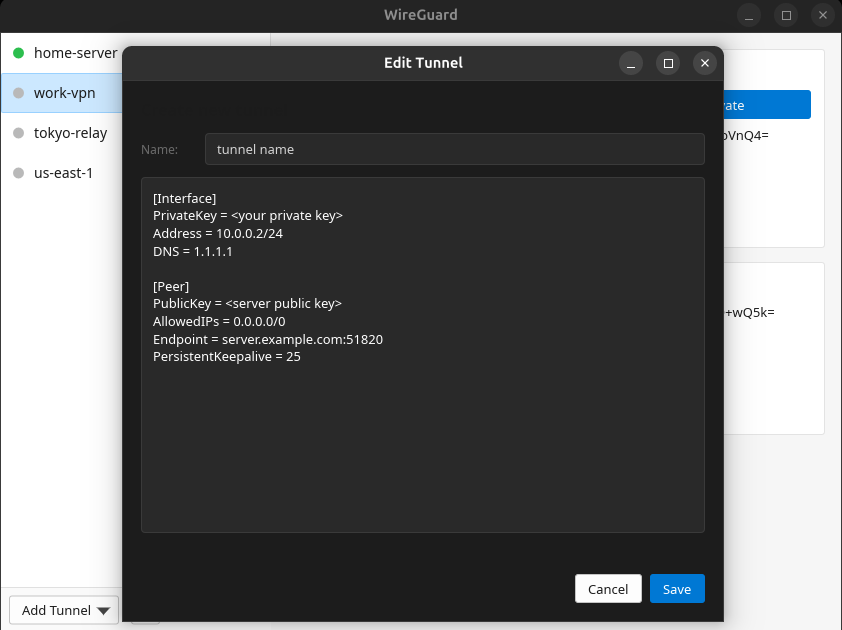
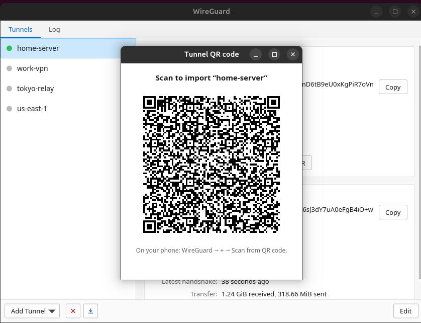

<div align="center">

# wireguard-gui

A native Linux desktop client for WireGuard.

Built with Rust + Slint. No Electron. No WebView. No NetworkManager layer. It
manages plain `/etc/wireguard/*.conf` tunnels through `wg` and `wg-quick`, and
keeps root operations behind a small auditable Rust helper.



[](https://github.com/JamilleJung/wireguard-gui/actions/workflows/ci.yml)
[](https://github.com/JamilleJung/wireguard-gui/releases/latest)
[](LICENSE)


</div>

Prefer the terminal? The sibling
[`wireguard-tui`](https://github.com/JamilleJung/wireguard-tui) provides the same
project philosophy as a keyboard-driven terminal UI.

## 💡 Design philosophy

`wireguard-gui` manages plain `/etc/wireguard/<name>.conf` files with `wg` and
`wg-quick`. It is a Linux desktop application, not a VPN provider, daemon,
configuration database, or NetworkManager plugin. Obtain a config from your
provider or configure both ends of your own tunnel first.

The GUI and [terminal sibling](https://github.com/JamilleJung/wireguard-tui)
share a file-based approach and some operations. They have separate interfaces,
packaging and feature sets; matching version numbers do not imply feature parity.

<a id="screenshots"></a>

## 🖼️ Screenshots

| Active tunnel | Inactive tunnel |
|---|---|
|  |  |

| Config editor | QR view |
|---|---|
|  |  |

These are historical interface examples; controls and layout differ in 1.9.2.
Values visible in these published config/QR screenshots are public; never reuse
their keys. The current controls are described below and in the
[tutorial](docs/TUTORIAL.md).

## ✨ What it does

- Lists saved tunnels, activates/deactivates them, and displays interface/peer
  details, recent handshake health, transfer totals and throughput.
- Imports one or several `.conf` files, or a PNG/JPEG QR-code image. A single
  import opens for review; multiple-file import saves valid files with unique
  names and skips failures.
- Creates an Interface-only, full-tunnel or split-tunnel preset with generated
  keys. Review and supply your own addresses, peer key and endpoint before use.
- Edits raw configs or simple multi-peer forms; comments, repeated directives,
  routing directives and unknown fields remain in raw text.
- Shows a complete config as a QR code, exports configs to ZIP, and manages
  private local backup archives.
- Offers systemd start-on-boot, connection diagnostics, journal viewing and
  helper-managed firewall kill-switch rules.
- Provides a tray menu where the desktop supports StatusNotifier items, an
  in-app Help guide, and a signed-release update flow.

<a id="install"></a>

## 📦 Install

Current release: **[1.9.2](https://github.com/JamilleJung/wireguard-gui/releases/tag/v1.9.2)**.
Choose a package for your CPU and Linux environment. WireGuard tools and the
required system libraries are not bundled into the tarballs.

| Download | Purpose |
|---|---|
| `wireguard-gui_1.9.2-1_amd64.deb` | Debian-family x86_64 package with GUI, helper, desktop entry, icon and polkit rule |
| `wireguard-gui-1.9.2-x86_64-linux.tar.gz` | Linux x86_64 binaries and installer assets |
| `wireguard-gui-1.9.2-aarch64-linux.tar.gz` | Linux ARM64 binaries and installer assets |
| `wireguard-gui-1.9.2-x86_64.AppImage` | x86_64 AppImage; optional in the workflow and attached if its optional build succeeds |
| `SHA256SUMS`, `SHA256SUMS.minisig`, `minisign.pub` | Artifact checksums, signature and public key |

### Verify a download

Download your artifact, `SHA256SUMS` and `SHA256SUMS.minisig` into one directory.
Install `minisign` and the system's SHA-256 tools, then verify the signed manifest
against the project key before checking the selected file:

```sh
asset=wireguard-gui-1.9.2-x86_64-linux.tar.gz
minisign -Vm SHA256SUMS -P RWSrokrj4nWGDhUf409+6yXuqPfF7WQuGtSk/PdsnTWKwfOpb3Hv4DxG
awk -v file="$asset" '$2 == file { print; n++ } END { if (n != 1) exit 1 }' SHA256SUMS > selected.sha256 &&
sha256sum --check --strict selected.sha256
```

Both signature and checksum checks must succeed. Change `asset` to the exact
filename you downloaded. A public key downloaded alongside an artifact is not
an independent trust anchor; compare it with the key committed in this repo or
use the inline key above. Releases fail rather than publish unsigned artifacts.

### Debian-family package

```sh
sudo apt install ./wireguard-gui_1.9.2-1_amd64.deb
wireguard-gui
```

The package installs under `/usr`; it **does not create the `wireguard` group or
add users to it**. For passwordless polkit access from an active local desktop
session, an administrator can grant the intended user membership:

```sh
sudo groupadd -f wireguard
sudo usermod -aG wireguard "$USER"
```

Log out and back in. Group members can manage all tunnels and read their keys;
only grant membership to trusted users. Without the passwordless rule matching,
`pkexec` may ask for administrator authentication or be denied by local policy.

### Extracted binary bundle

After verification, extract the tarball for your CPU, enter its directory and
run the installer as your normal user:

```sh
tar -xzf wireguard-gui-1.9.2-x86_64-linux.tar.gz
cd wireguard-gui-1.9.2-x86_64-linux
./install.sh
```

The installer recognizes the adjacent prebuilt application/helper when no Cargo
manifest is present, stages them with executable permissions, and skips Rust,
compiler and development-header setup. It still installs runtime dependencies
and helper authorization. An incomplete bundle is rejected.

You can launch the adjacent application to inspect the interface, but release
helper discovery requires trusted root ownership and directory ancestry. Run
the verified installer for usable privileged integration; a normal user-owned
adjacent helper is refused.
AppImage users likewise need helper authorization; an installed helper provides
the usual system integration. Use your package manager for package-managed
upgrades rather than mixing installation prefixes.

### Build from source

```sh
git clone https://github.com/JamilleJung/wireguard-gui.git
cd wireguard-gui
./install.sh
```

A source checkout builds with Rust and Slint development libraries. The installer
supports `apt-get`, `dnf`/`yum`, `pacman`, `zypper`, `apk`, `xbps-install` and
`eopkg`; it installs dependencies, builds as the invoking user when that user
can be determined, then installs under `/usr/local` by default.

```sh
./install.sh             # default: per-user sudoers grant for the helper
./install.sh --polkit    # group-restricted polkit rule instead
./install.sh uninstall   # leaves /etc/wireguard configs in place
```

The script creates `wg-gui` as an alias for `wireguard-gui`. Cargo builds and the
provided distro-package recipes do not create that alias. A direct root login
requires explicit `--allow-root` (or `WG_ALLOW_ROOT=1`); normal-user installation
is the recommended path. See [distro notes](docs/DISTROS.md) and
[packaging details](packaging/PACKAGING.md).

## 🎮 Usage

```sh
wireguard-gui            # launch; a second launch raises the existing window
wireguard-gui --version  # also -V; no window
wireguard-gui --help     # also -h; no window
```

There are no GUI `doctor`, `setup` or command-line tunnel-management subcommands.
An unknown first argument exits with status 2.

- **Tunnels:** select a tunnel; use **Activate**, **Deactivate**, **Diagnose**,
  **Show QR**, **Start on boot** or **Edit**. The bottom bar provides **Add
  Tunnel**, delete and export-all. The menu button opens **Help…**, **Check for
  updates…** and **About…**.
- **Advanced ▾** on the selected tunnel card reveals **Kill switch**, **Running
  cfg** and **Save live**. There is no global Easy/Advanced mode. The expansion
  preference is saved, not a separate preference per tunnel.
- **Edit fields / Config text:** common Interface and Peer fields, peer
  navigation/add/remove, keypair/PSK generation, and copy actions. **Advanced
  fields** reveals Listen port and MTU. New entries use **Create** or **Create &
  Activate**; existing entries use **Save**. Changing Name renames the tunnel.
- **Log:** refresh, substring filter, **This tunnel**, save, clear the displayed
  buffer, or copy. Clearing does not delete the system journal.
- **Backup:** **New backup**, select an archive, then restore, export or delete.

Saved active-tunnel edits attempt `wg syncconf`. Changes to Address, DNS, MTU,
Table or routes still need deactivation/reactivation; a successful live sync
only applies WireGuard runtime settings. Renaming stops an active old interface
and preserves its systemd enablement where available; it does not activate the
new name automatically.

### Validation and responsiveness

Imported config files must be regular files at most 1 MiB. Named pipes and
other special files are rejected without waiting for a writer.

Config validation is shared by the frontend and privileged helper. It checks
every directive occurrence, known sections/field placement, canonical 32-byte
WireGuard base64 keys (including padding bits), numeric CIDR/port/keepalive
bounds, and required peer fields. Inline comments, repeated Interface sections,
repeated Address/DNS/AllowedIPs, scoped IPv6 endpoints, named/numeric Table,
FwMark hex/off and SaveConfig booleans are supported. Unknown fields or malformed
sections stay visible in raw text but cannot be saved until corrected. If a
PresharedKey directive is present it must contain a valid key; omit it to use
no PSK. The helper independently rejects all four root script-hook directives.

Heavy tunnel/editor/import/QR/export/backup operations run outside the GUI event
loop. A shared busy guard rejects conflicting operations, and stale list/detail
results do not replace a newer selection or draft. Local dialogs/file writes
and bounded clipboard work can still briefly block; this is not a promise
that every callback is asynchronous.

### Backups and sensitive data

User backups live under `$XDG_DATA_HOME/wireguard/backups` (an absolute XDG
path), or `~/.local/share/wireguard/backups`, shared by both applications.
Existing managed backup directories must belong to the current user and are
checked/tightened to `0700`; symlink directories are refused. ZIPs and exported
copies use `0600`. New backup names are unique even within one second and are
published without overwriting another archive.

Export reads every listed tunnel successfully or reports an error. It no longer
reports a successful incomplete archive after a helper/read failure. Exports
and saved logs are written to a completed private sibling file and then
published atomically: failed writes preserve the old destination, final
symlinks are refused, and replacing a hardlink does not modify its other names.

Restore accepts only valid, unique, top-level `.conf` entries. It rejects
malformed/duplicate archive names, invalid configs and hooks before its first
save. Limits are **64 MiB per ZIP**, **4,096 archive entries**, **1,024 configs**,
**1 MiB per config**, and **16 MiB total config text**. Unrelated files are
skipped. Backup reads require an owned regular file with one hard link and
refuse symlinks/FIFOs; copy a hardlinked archive to an ordinary file first.

After complete preflight, restore still saves sequentially. It overwrites
matching saved names, leaves other tunnels in place, and does not sync running
interfaces. A later operational failure can leave a partial restore; it is not
a multi-file transaction. Helper per-file backups remain a separate recovery
source under `/etc/wireguard/.backup/`. All these archives contain unencrypted
private keys.

### Kill switch and start-on-boot

Only **one helper-managed kill switch** can be active at a time across managed
tunnels. Turn the existing one off before enabling another. The helper requires
an already-active interface; it can assign an unused runtime WireGuard fwmark
without changing the saved config. It does not activate a stopped tunnel as a
side effect of enabling a switch.

The helper prefers nftables and requires a real hooked filter OUTPUT base chain.
It applies its complete rule set as one nft batch. The fallback requires
`iptables` and `iptables-restore`; when the kernel exposes IPv6 support it also
requires `ip6tables` and `ip6tables-restore`, even before a non-loopback IPv6
address is assigned. Both families are preflighted; commits are atomic **per
family**, not one transaction across IPv4 and IPv6. Failures are reported.

The rules allow loopback, the selected tunnel, its marked transport traffic,
and detected established SSH return traffic when `SSH_CONNECTION` reaches the
helper, then reject other host output ahead of existing allows. Exact comments
isolate tunnel names; status requires the complete expected rule set. This is
host-output control, not server forwarding/NAT or a general no-leak guarantee.
It may disrupt remote access or interact with another firewall manager.

Down/delete/rename retain protection if the interface is still active or its
state is unknown, and report stop/cleanup failures. A failed operation can
leave a tunnel stopped or partially changed; inspect the error and current
state before retrying. App exit does not clear rules. External service changes
may leave stale rules, and firewall reloads may remove them. No persistence
daemon is installed. After upgrading, reapply an existing switch (off/on) to
install current rules, planning for that brief unprotected interval and keeping
another administrative access path available.

**Start on boot** enables/disables the systemd `wg-quick@<name>` service. It
changes future boot activation, not desktop login autostart or current state.
Other init systems need their own service configuration.

### Setup, diagnostics and updates

The Setup window opens at startup when a critical prerequisite is missing. It
checks tools, helper/auth, config directory, DNS integration, clock-sync status,
systemd and journald availability. The helper check uses the same resolver as the backend. Polkit rule presence is
a warning that session/group authorization is unverified, not a successful
authorization result.
**Show commands** gives suggested fixes;
**Re-check** checks again; **Skip for now** opens the main window. It does not
probe kernel-module availability.

**Fix automatically** runs selected system commands through `pkexec`: install
WireGuard tools or a DNS provider, enable an inactive systemd-resolved service
when its compatibility shim is detected, and create `/etc/wireguard` if needed.
It does not install/authorize the helper, create tunnel configs or connect them.
Read the proposed commands before applying system changes.

**Diagnose** checks clock sync, interface/handshake state, endpoint ping and
basic DNS. Results are hints, not proof that a VPN endpoint, routing or firewall
is correctly configured; blocked ICMP alone does not prove a server is down.

Startup and manual update checks contact GitHub using `curl`. To disable the
startup check, set `WG_NO_UPDATE_CHECK=1` or create
`${XDG_CONFIG_HOME:-$HOME/.config}/wireguard-gui/no-update`. Opening the Updates
window still checks manually. **Update now** verifies the architecture-specific
tarball with the compiled-in minisign key and its exact signed checksum, then
runs its installer. It needs `curl`, `tar`, `sha256sum`, `minisign` and normally
`pkexec`; automatic minisign installation is only best-effort. The installer
uses its normal prefix/auth defaults, not package-manager integration. Restart
the app after installation. See the [tutorial](docs/TUTORIAL.md#updates).

## 🛡️ Security and privilege model

Run the GUI as a normal user. The helper client chooses direct execution if
already root, otherwise a working `sudo -n` grant, then `pkexec`. Install/setup
and update actions can also run installer/package commands with administrator
authorization. A passwordless helper grant permits control of all managed
tunnels and access to their keys, not isolation between users.

The helper uses fixed tool locations and verbs, validates names, writes saved
configs through a `0600` temporary file with sync and rename, and records
mutating actions with secret redaction. It rejects `PreUp`, `PostUp`, `PreDown`
and `PostDown` on save/rename. Configs placed directly by an administrator remain
that administrator's responsibility: activating one runs `wg-quick` normally.
See [SECURITY.md](SECURITY.md) for the boundary and accepted dependency notices.

## Audited helper, installer and update behavior

Release helper discovery uses this project's own standard `/usr/local/lib/`
and `/usr/lib/` paths, or an adjacent **trusted** executable. The executable must
be root-owned, executable and not group/other writable; its directory ancestry
must also be trusted. A normal user-owned extracted helper is not automatically
trusted: install the verified bundle first. Release builds no longer fall back
to the source build directory or another application's helper. Debug overrides
remain available for development; they do not create an authorization grant.

Background read-only requests use a noninteractive polkit check before pkexec,
so missing authorization produces an actionable error instead of repeated
password dialogs. Explicit mutating actions can still request authentication.
Helper IPC drains input/output concurrently, retains at most 4 MiB per output
stream, and has an overall 90-second deadline plus bounded pipe cleanup. Local
key-generation commands have a 10-second deadline. A privileged process that
the UI user cannot signal may finish independently after a UI-side timeout;
check actual tunnel state before retrying.

Before privileged writes or helper grants, `PREFIX` must be an absolute ASCII
path containing only letters, digits, `/`, `_`, `.` and `-`, with no empty,
`.` or `..` components or trailing slash. Existing directory ancestors must be
root-owned without group/other write permission; symlinks are refused. A
group-writable `/usr/local` can therefore fail these checks. An administrator
must choose or prepare a protected path; the installer does not take ownership
of caller directories. `--polkit` supports only `/usr` or `/usr/local`, matching
the bundled rule. Custom sudoers prefixes still require matching frontend helper
discovery configuration.

Installer options are validated; unknown options fail instead of being ignored.
Source builds use the lockfile. Switching sudoers/polkit modes installs and
validates the selected grant before removing the previous grant. Failed sudoers
validation or group enrollment reports failure and keeps prior authorization.
`--polkit` requires pkexec up front; it does not install a rule and then claim
success without the escalation tool. Packages still do not enroll users.

Verified updates retain ownership of their private download directory through
installation and clean it up on download, staging or installation failure and
normal completion. Before privilege escalation, the whole required bundle is
checked: regular single-link application/helper/installer/assets, no symlink
components, and a fresh exclusive staging tree. Missing/unsafe assets fail before
installation starts. HTTPS-only redirects are enforced. GUI automatic updates
support its published x86_64/ARM64 builds; unsupported CPUs fail explicitly.

Update download rechecks that the verified version is newer than the running
version. The completed update reports that verified version, and still needs
an application restart. Prefer a package-manager upgrade for a packaged install.

## 🔧 Hacking on it

See [CONTRIBUTING.md](CONTRIBUTING.md) for prerequisites, source layout, checks,
helper development and documentation conventions. A quick Linux check is:

```sh
cargo fmt --all -- --check
cargo clippy --all-targets --locked -- -D warnings
cargo test --locked
cargo build --release --locked
shellcheck -S warning install.sh tests/helper-validation.sh tests/installer-sanity.sh
bash tests/helper-validation.sh target/release/wg-helper
bash tests/installer-sanity.sh
```

## 🐛 Troubleshooting

- **Active, but no traffic:** use Diagnose and check server peer registration,
  endpoint, routing, firewall, DNS and clock sync. An up interface does not prove
  a handshake or useful traffic; idle peers can also have an old handshake.
- **DNS activation fails:** `DNS =` needs a working `resolvconf` compatibility
  command. If it is the `resolvectl` shim, systemd-resolved must be active.
- **Helper prompts or fails:** check the installed helper path, sudoers grant or
  active-local `wireguard` group membership; see [distro notes](docs/DISTROS.md).
- **No tray icon:** your desktop needs a StatusNotifier/AppIndicator host.
  Closing quits when no tray host is available; otherwise use tray **Quit**.
- **Blank inputs/window:** check graphics/runtime libraries. On proprietary
  NVIDIA + Wayland with `DISPLAY` available, the app prefers XWayland; set
  `WG_FORCE_WAYLAND=1` to opt out of that workaround.
- **Missing logs/boot control:** journal viewing needs `journalctl`; the boot
  toggle needs systemd. Avoid managing the same interface in another tool.

## ⭐ Star this project

If `wireguard-gui` is useful to you, **please give it a star on GitHub** - it
genuinely helps other people discover the project and motivates further work.

👉 **[Star wireguard-gui on GitHub](https://github.com/JamilleJung/wireguard-gui)** ⭐

You can also **watch** the repo for releases and **fork** it to hack on your own ideas.

## ☕ Buy me a coffee

This is a free, open-source project built in spare time. If it saved you some
trouble and you'd like to say thanks, a coffee is hugely appreciated 💛

<div align="center">

[](https://www.buymeacoffee.com/jamillejung)

**[☕ buymeacoffee.com/jamillejung](https://www.buymeacoffee.com/jamillejung)**

</div>

## 📄 License

MIT. WireGuard is a registered trademark of Jason A. Donenfeld. This is an
independent, unofficial client and is not affiliated with or endorsed by the
WireGuard project.
