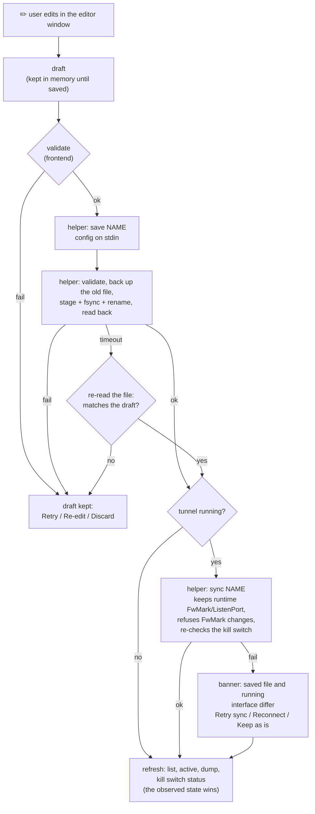
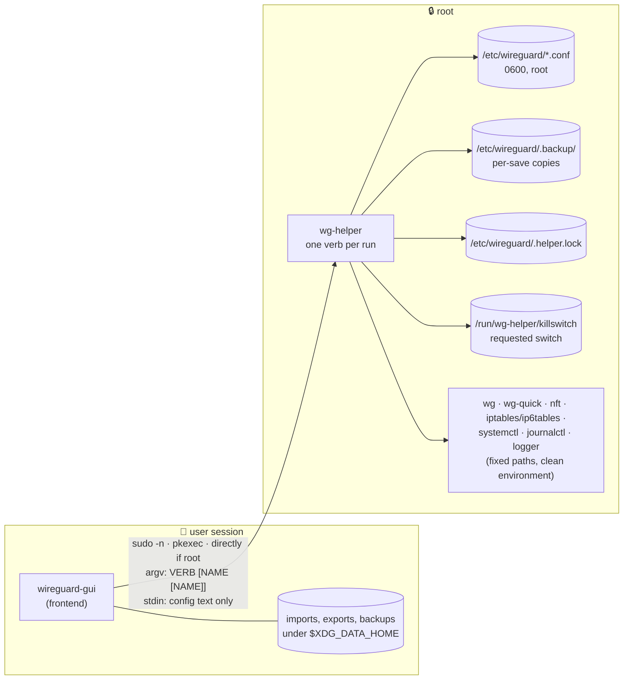
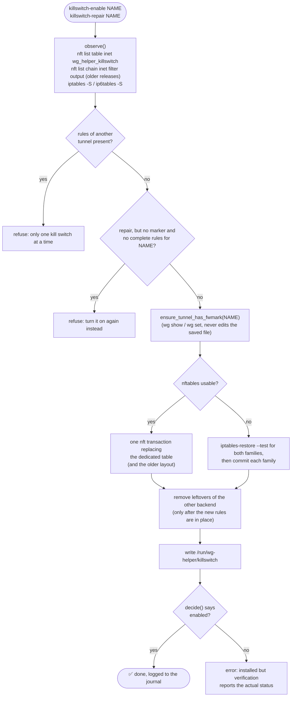
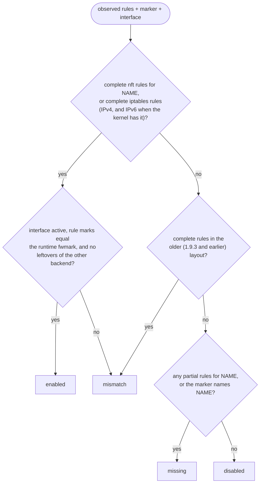

# 🏗️ Architecture

This document describes how `wireguard-gui` is put together, where the
privilege boundary is, and how data moves between the desktop UI, the
privileged helper and the system. Read it before changing anything under
`src/bin/wg-helper/`, `src/backend/` or the installer.

## Processes

| Binary | Runs as | Source |
| --- | --- | --- |
| `wireguard-gui` | the logged-in user | `src/main.rs`, the modules below and `ui/*.slint` |
| `wg-helper` | root (via sudo, pkexec, or directly when already root) | `src/bin/wg-helper/` |
| `wireguard-gui --internal-decode-qr` | the logged-in user, short-lived | `src/qr_isolate.rs`: decodes one QR image in a child process with a memory limit and a deadline |

`src/config.rs`, `src/validation.rs` and `src/secrets.rs` are compiled into
both binaries, so the frontend and the helper validate and redact configs with
the same code. The helper is the authority: the frontend validates to give
early feedback, the helper validates again before anything touches
`/etc/wireguard`.

## Frontend modules

| Module | Responsibility |
| --- | --- |
| `main.rs` | entry point: CLI parsing (`--theme`, `--help`, `--version`), single instance, window and tray setup |
| `state.rs` | shared application state |
| `events.rs` | UI callbacks wired to actions |
| `actions.rs` | user actions that start background operations; kill switch repair planning |
| `ops.rs` | operation state machine (Idle → Running → Succeeded / Failed / Unknown → reconciled); refuses overlapping mutations |
| `draft.rs` | editor draft lifecycle (kept on any failure; Retry / Re-edit / Discard) |
| `live.rs` | periodic refresh, health tracking, automatic kill switch repair with backoff |
| `tray.rs` | system tray (StatusNotifierItem) |
| `ui_bridge/` | Rust ↔ Slint models: editor and editor form, windows, help markdown |
| `ui/*.slint` | the interface: `theme`, `widgets`, `main_window`, `editor`, `dialogs` |
| `theme.rs`, `layout.rs` | default, high-contrast and ASCII themes; window-size breakpoints, peer paging, the shortcut list |
| `backend/` | everything that talks to the helper or reads user files: `helper.rs` (invocation), `error.rs` (typed `HelperError`), `status.rs` (kill switch and tunnel status), `verify.rs` (observed-state checks after actions), `backup.rs` (ZIP export/restore with rollback), `qr.rs`, `health.rs` (per-peer health), `diagnostics.rs` |
| `import_parse.rs`, `qr_isolate.rs` | backup ZIP and QR import parsing with limits (shared with the fuzz targets); the isolated QR decoder child |
| `safe_file.rs` | the one routine for opening user-supplied files (no blocking on FIFOs/devices, regular files only, size limits) |
| `create.rs`, `clipboard.rs` | Interface-only / full / split tunnel presets; copy-value normalization |
| `logging.rs` | opt-in structured debug log (`WG_GUI_LOG`), always redacted |
| `doctor.rs` | environment checks behind the startup Setup window and Diagnose's clock check (there is no `doctor` subcommand) |
| `update.rs` | verified self-update that preserves the install method and authorization mode |
| `ui_tests.rs` | tests that drive the real Slint windows on a headless backend |

## Data flow of an edit

## Health

`backend/health.rs` classifies each peer from successive `wg show dump`
snapshots: handshake age, rx/tx deltas, persistent keepalive and time since
activation. WireGuard only handshakes when there is traffic, so an old
handshake on a quiet tunnel is **Idle**, not a failure. **Handshake stale**
needs a persistent keepalive whose handshake has expired; **Connection failed**
needs packets sent for longer than the 90-second retry window without an
answer, or a keepalive peer that never completed a handshake. The tunnel shows
its most severe peer state. The system clock is mentioned only as a possible
cause, and only when handshakes are actually failing.

## Privilege boundary

The frontend never runs a WireGuard or firewall tool as root itself. It runs
`wg-helper VERB [NAME [NAME]]`; the helper:

1. accepts only the fixed verbs in `verb_shape()` (`src/bin/wg-helper/main.rs`)
   and tunnel names matching `name_ok()` — no paths, options or shell text;
2. takes the shared mutation lock (`/etc/wireguard/.helper.lock`, bounded
   wait) for every mutating verb, so the TUI and GUI cannot interleave;
3. runs tools only from `/usr/sbin:/usr/bin:/sbin:/bin` with a cleared
   environment (only a fixed `PATH` and `LC_ALL=C`), bounded output, and a
   deadline enforced from the parent;
4. opens configs with `O_NOFOLLOW | O_NONBLOCK`, requires an owned regular
   file with one link and no group/other write bit, and caps input at 1 MiB;
5. validates configs and refuses `PreUp`/`PostUp`/`PreDown`/`PostDown`
   (they would run as root);
6. writes with stage → fsync → rename, keeping a backup of the old file;
7. checks the resulting state after every mutation (interface up/down,
   file present/absent, start-on-boot state, kill switch verified) and, after
   a timeout, reports the state it observed instead of guessing;
8. writes one structured, redacted `key=value` audit record per mutation to
   the journal (`journalctl -t wireguard-gui`).

Authorization is either a sudoers drop-in scoped to the helper path or a
polkit rule scoped to the helper path and the `wireguard` group (see
`packaging/49-wireguard-gui.rules`). Read-only polling never opens an
authentication dialog: with pkexec it first asks `pkcheck` without user
interaction. The full threat model is in [SECURITY.md](../SECURITY.md).

## Helper modules

| Module | Responsibility |
| --- | --- |
| `main.rs` | verb table, name validation, lock, outcome logging |
| `process.rs` | fixed-path tool lookup, clean environment, bounded I/O, deadlines |
| `fsutil.rs` | private dirs, lock file, link-safe reads, backups, atomic writes |
| `runtime.rs` | `wg show`/`wg set`: interface state, fwmark, listen port, sync merge |
| `commands.rs` | tunnel verbs (`up`, `down`, `save`, `rename`, `delete`, `sync`, …) |
| `firewall/mod.rs` | kill switch policy, status decision, requested-state marker |
| `firewall/nft.rs` | nftables backend: dedicated `inet wg_helper_killswitch` table |
| `firewall/iptables.rs` | iptables backend: dedicated `WGH-KILLSWITCH` chain |
| `logging.rs` | structured, redacted journal records |

## Kill switch data flow

`killswitch-enable NAME` and `killswitch-repair NAME` share one install path:

`decide()` (pure, unit-tested) turns what was observed into one status:

| Status | Meaning | Frontend reaction |
| --- | --- | --- |
| `enabled` | complete rules whose mark equals the runtime fwmark | none |
| `disabled` | no rules and no request | none |
| `missing` | requested (marker) but rules gone or incomplete, including an iptables jump that is no longer the first `OUTPUT` rule | run `killswitch-repair` |
| `mismatch` | rules present but stale: mark differs, interface down, older layout or leftovers | run `killswitch-repair`; if the interface is down, report it |

The frontend (`RepairPlanner` in `actions.rs`, driven by `live.rs`) repairs
only an active tunnel: once as soon as the loss is seen, then 15 seconds and 90
seconds after the previous attempt, at most three times per loss. A status the
frontend cannot read is shown as unknown, never as off.

Why the rules look the way they do:

* **Dedicated table / chain.** nftables `accept` ends only the current base
  chain, so exceptions in a separate table never override another table's
  `drop`. In iptables an `ACCEPT` in a jumped chain is final for the table,
  so the kill switch chain `RETURN`s allowed traffic to `OUTPUT`, where the
  administrator's later rules still apply, and the jump must be the first
  `OUTPUT` rule.
* **Exceptions.** Loopback; packets routed into the tunnel interface
  (unmarked plaintext); WireGuard's transport (the runtime fwmark); IPv6
  router/neighbor solicitation and neighbor advertisement with hop limit 255
  and MLDv2 reports with hop limit 1 (without them an IPv6 endpoint becomes
  unreachable once its neighbor cache entry expires); DHCPv4/DHCPv6 client
  traffic (lease renewal); return traffic of the SSH session the switch was
  enabled from. IPv4 ARP is not IP and is not filtered by these hooks.
* **Live config updates.** `wg syncconf` resets interface fields that the
  file omits — including the fwmark wg-quick sets at runtime. `sync` merges the
  live fwmark and listen port into the stripped config, refuses a config that
  changes the fwmark of a running tunnel (reconnect instead), re-reads the mark
  afterwards and repairs the kill switch if needed.
* **Firewall reloads.** A reload (`nft flush ruleset`, firewalld, a distro
  ruleset) can remove the rules. The marker under `/run` keeps the request, so
  status turns `missing` and the frontend repairs it. The marker is on tmpfs,
  so, like the rules, a kill switch does not survive a reboot.

These behaviours are exercised against real kernels by
`tests/firewall-namespace.sh` (rule batches, atomicity, foreign rules kept)
and `tests/killswitch-e2e.sh` (a real tunnel in network namespaces, IPv4 and
IPv6 endpoints, nftables and iptables). How to run them:
[CONTRIBUTING.md](../CONTRIBUTING.md#namespace-and-kill-switch-end-to-end-tests).
