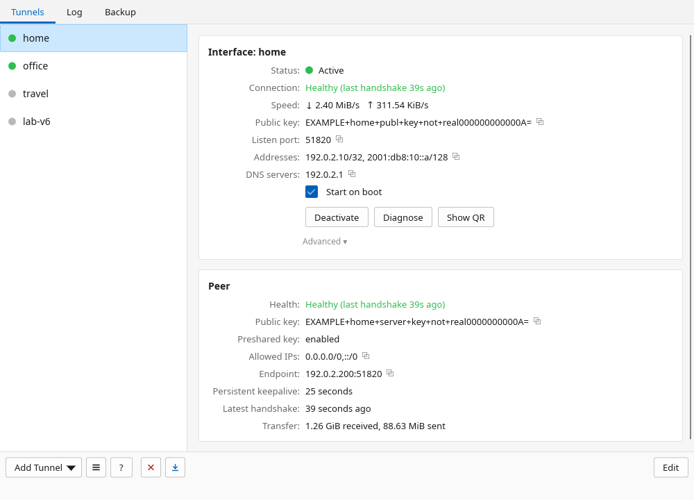
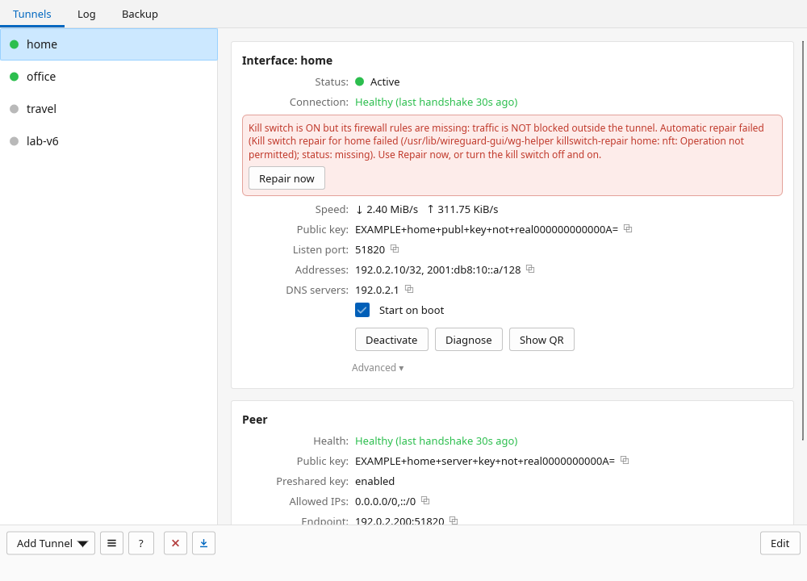
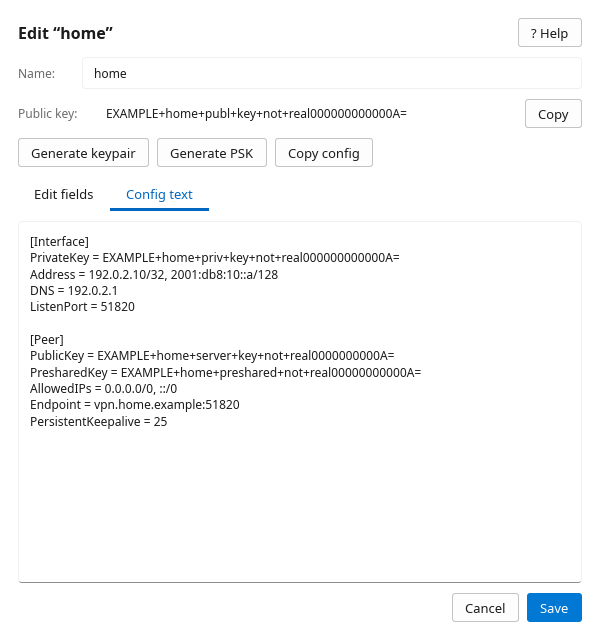
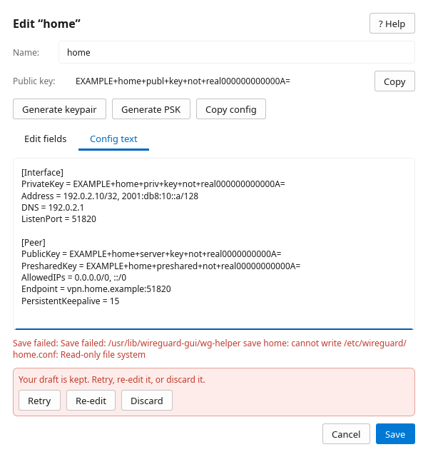
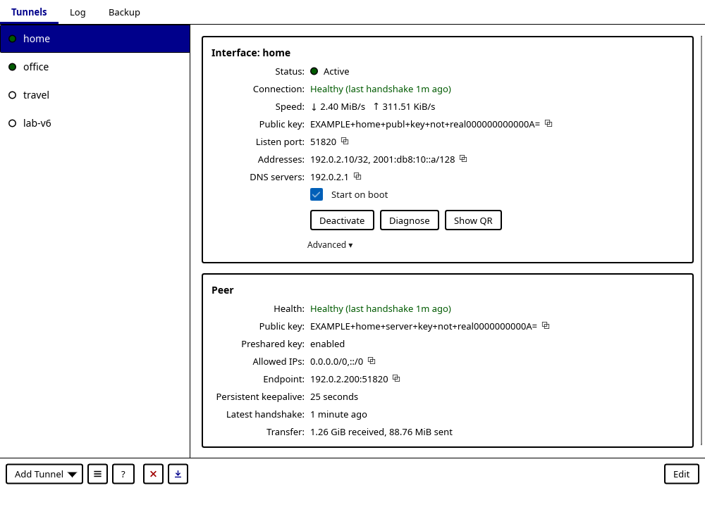
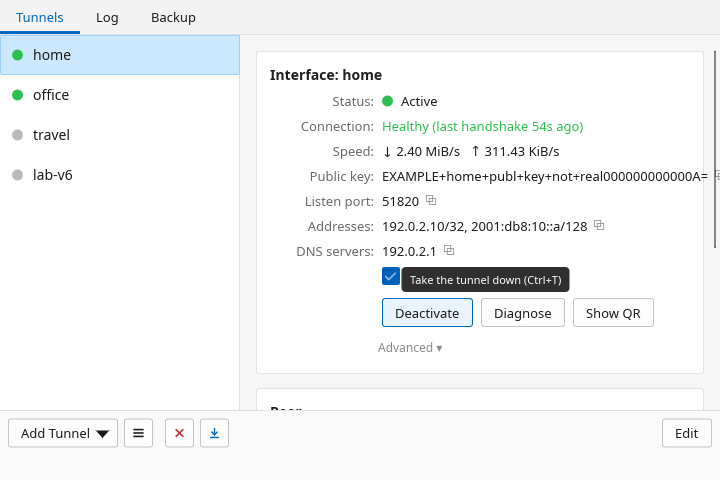

<div align="center">

# 🧭 The wireguard-gui tutorial

### From zero to a connected tunnel, one friendly step at a time.



<sub>Fictional tunnels, fake keys. Please don't try them; they won't try you back.</sub>

</div>

---

This guide walks you through installing `wireguard-gui`, getting your first
tunnel in, connecting, reading the live health, putting a tunnel on your phone,
and all the small print: start-on-boot, the kill switch, editing safely, logs,
backups, updates and troubleshooting. No WireGuard experience needed. 🙂

It describes **1.10.0** (what changed is in the
[changelog](../CHANGELOG.md)). The in-app Help (<kbd>F1</kbd>) is the [same guide to WireGuard
itself](help.md), built into the binary.

> [!TIP]
> Brand new to WireGuard? Read [The 60-second mental model](help.md#the-60-second-mental-model)
> and [The keys](help.md#the-keys-this-is-the-whole-security-model) first. Two
> minutes, and every field below will make sense.

**Steps:**
[1. Before you start](#1--before-you-start) ·
[2. Install](#2--install) ·
[3. First launch](#3--first-launch-and-the-setup-window) ·
[4. Get a tunnel in](#4--get-a-tunnel-in-three-ways) ·
[5. Connect](#5--connect-and-read-the-health) ·
[6. Show QR](#6--put-a-tunnel-on-your-phone-with-show-qr) ·
[7. Start on boot](#7--start-on-boot) ·
[8. Kill switch](#8--the-kill-switch) ·
[9. Edit safely](#9--edit-safely) ·
[10. Logs](#10--read-the-logs) ·
[11. Backups](#11--backups-export-and-restore) ·
[12. Updates](#12--updates) ·
[13. Shortcuts and themes](#13--shortcuts-themes-and-small-screens) ·
[14. Troubleshooting](#14--troubleshooting)

## 1. 🧰 Before you start

You need:

- a Linux graphical session (X11 or Wayland);
- WireGuard tools (`wg`, `wg-quick`) and kernel support. The installer and the
  Setup window help with the tools; the app does not bundle them;
- a tunnel config from your VPN provider or your own server. This app is a
  client for configs you bring; it is not a VPN provider and it does not
  register keys on a remote server for you.

Upstream background: the [WireGuard quick start](https://www.wireguard.com/quickstart/)
and [installation guide](https://www.wireguard.com/install/).

> [!IMPORTANT]
> Treat `.conf` files like passwords. They usually contain your **private key**
> (and maybe a preshared key). The same goes for QR codes, ZIP exports,
> backups, **Running cfg** and full-config clipboard copies.

## 2. 📦 Install

Pick one. The [README's install section](../README.md#-install) has the full
download table and the [ten-second signature check](../README.md#-verify-first-it-takes-ten-seconds) —
please do it before running a downloaded binary.

**🐧 Debian / Ubuntu / Mint (x86_64)**

```sh
sudo apt install ./wireguard-gui_<version>-1_amd64.deb
```

The package installs the app, helper, launcher, icon and a polkit rule, but it
does **not** put anyone in the `wireguard` group. For passwordless use from your
desktop session, an administrator adds you once:

```sh
sudo groupadd -f wireguard
sudo usermod -aG wireguard "$USER"   # then log out and back in
```

The rule needs both the group **and** an active local session (an SSH session
alone doesn't count). Group members can read every key and manage every tunnel,
so only add people you trust.

**📦 Prebuilt tarball** (x86_64, i686, aarch64 or armv7: pick the one that matches `uname -m`)

```sh
tar -xzf wireguard-gui-<version>-x86_64-linux.tar.gz
cd wireguard-gui-<version>-x86_64-linux
./install.sh
```

The installer spots the prebuilt binaries and skips Rust and the compiler. It
still installs runtime packages and sets up helper authorization, and it refuses
a bundle built for a different CPU.

**🛠️ From source**

```sh
git clone https://github.com/JamilleJung/wireguard-gui.git
cd wireguard-gui
./install.sh
```

Run it as your normal user; it asks for privileges where it needs them. By
default it installs under `/usr/local` with a scoped sudoers grant for the
helper. `./install.sh --polkit` uses a group-restricted polkit rule instead. A
direct root login needs `--allow-root` (or `WG_ALLOW_ROOT=1`), so only choose
that on purpose.

<details>
<summary>🧹 The <code>wg-gui</code> alias, AppImage and uninstalling</summary>

- `install.sh` also creates a short `wg-gui` alias. Packages and Cargo builds
  don't, so launch `wireguard-gui` there.
- The AppImage can run the UI, but it does not authorize a helper for you; use
  an installed helper for everyday privileged work.
- `./install.sh uninstall` removes what the installer added. Your tunnels in
  `/etc/wireguard` stay put. Remove a package with its package manager, and
  don't mix a `/usr` package with a `/usr/local` install.
- Per-distro notes, DNS resolvers and SELinux: [DISTROS.md](DISTROS.md).

</details>

## 3. 🚀 First launch and the Setup window

Launch **WireGuard** from your app menu, or run `wireguard-gui`. Launching it a
second time just raises the window you already have. `--help` and `--version`
print without opening a window; there are no tunnel subcommands.

If something critical is missing, a friendly **Setup** window appears first.
It checks the WireGuard tools, the helper and its authorization,
`/etc/wireguard`, DNS integration, clock sync, systemd and the journal:

| Button | What it does |
|---|---|
| **Show commands** | Shows the suggested commands so you can run them yourself. |
| **Fix automatically** | Uses `pkexec` for the safe fixes: install WireGuard tools or a resolvconf provider, enable an inactive systemd-resolved, or create `/etc/wireguard` (mode `0700`). |
| **Re-check** | Runs the checks again. |
| **Skip for now** | Opens the main window anyway. |

> [!NOTE]
> Setup never installs or authorizes the helper, imports configs, connects a
> tunnel or turns on start-at-boot. It doesn't check kernel modules either. A
> polkit rule being *present* is shown as a hint, not as proof that your
> session and group match it. Critical checks run again on the next launch.

## 4. 📥 Get a tunnel in three ways

All three start at **Add Tunnel** (bottom left) and end in the editor, where you
review and save. No tunnels yet? The empty main window has **Import .conf**,
**Import QR image** and **New tunnel** buttons too.

### (a) 📄 Import a `.conf` file

The quickest path when a provider or another device gave you a config.

1. **Add Tunnel → Import tunnel(s) from file…** (<kbd>Ctrl</kbd>+<kbd>O</kbd>).
2. Pick one or more `.conf` files.
3. **One file** opens in the editor with a suggested, unique name that you can
   change. **Several files** are imported in one go: valid ones get unique
   names, invalid ones are skipped, and nothing existing is ever overwritten.

### (b) 🔳 Import a QR-code image

Handy when the config arrives as a QR code you have a screenshot or photo of.

1. **Add Tunnel → Import from QR code…** (<kbd>Ctrl</kbd>+<kbd>I</kbd>).
2. Pick a PNG or JPEG image. It reads an image file, not a camera.
3. Every QR code in the picture is checked: broken or unrelated ones are skipped,
   exactly one valid tunnel opens for review, and an image with several
   different tunnels is refused. The QR has to contain the WireGuard config
   text itself, not a link to a provider's website.

### (c) ✨ Create one from a preset

For building your own config. **Add Tunnel → Create tunnel…**
(<kbd>Ctrl</kbd>+<kbd>N</kbd>) opens the **Full tunnel** preset with a
brand-new key pair. Each preset button starts over with a new key, so choose
your preset *before* typing in real settings:

| Preset | Starts with |
|---|---|
| **Interface only** | Address `10.0.0.2/32`, no peer |
| **Full tunnel** | Address `10.0.0.2/32`, DNS `1.1.1.1`, AllowedIPs `0.0.0.0/0, ::/0`, an example endpoint and keepalive 25 |
| **Split tunnel** | Address `10.0.0.2/32`, AllowedIPs `10.0.0.0/24`, an example endpoint and keepalive 25 |

These are templates, not VPN access. Fill in the address your server assigned,
the peer's public key and endpoint, and register *your* public key (shown next
to the private key, with a **Copy** button) at the other end.

### 🏷️ Naming and saving

The name becomes both `/etc/wireguard/<name>.conf` and the Linux interface name:
**1–15** ASCII letters, digits, `_`, `.` or `-`, starting with a letter or digit,
with no `..`, no slashes and no `.conf` suffix.

Look over the keys, addresses, AllowedIPs and endpoint, then choose **Create**
to save, or **Create & Activate** to save and connect. If activation fails after
creating, the saved tunnel is still there to fix.

> [!WARNING]
> The helper refuses configs with `PreUp`, `PostUp`, `PreDown` or `PostDown`.
> Those commands would run as root, and an editor warning doesn't make them
> saveable.

## 5. 🔌 Connect and read the health

1. Click a tunnel in the list. Its **Interface** and **Peer** cards appear on
   the right.
2. Press **Activate** (<kbd>Ctrl</kbd>+<kbd>T</kbd>). The app runs `wg-quick up`
   and then checks that the interface really came up, instead of trusting an
   exit code.
3. Press **Deactivate** to bring it down again.

The cards show the public key, listen port, addresses, DNS, live speed, and for
each peer its endpoint, allowed IPs, latest handshake and transfer, including
peers that only exist at runtime.

### 🩺 The six health states

WireGuard only talks when it has something to say. So an old handshake on a
quiet tunnel isn't a funeral, it's a nap. 😴 That's why the app looks at
handshake age **and** traffic **and** keepalive before it calls anything broken:

| | Health | Means |
|---|---|---|
| 🟢 | **Healthy** | A handshake completed in the last 3 minutes. |
| 🔵 | **Connecting…** | A handshake is in progress (traffic started, or keepalive is on), still within WireGuard's retry window. |
| ⚪ | **Idle** | No recent traffic and no keepalive, so no fresh handshake is expected. Totally normal. |
| 🟡 | **No traffic** | Up, but nothing has been sent or received yet. |
| 🟠 | **Handshake stale** | Persistent keepalive is on, yet the handshake has expired. |
| 🔴 | **Connection failed** | Packets went out for over 90 seconds without a reply, or a keepalive peer never completed a handshake. |

Every peer gets its own line, and the tunnel shows its most serious peer state,
so one failing peer is never hidden behind a healthy one (for example
*Connection failed — 1 of 3 peers*). Tunnels with more than one peer show
five at a time: **Prev** / **Next** page through them, and **Filter peers**
matches a key, endpoint or AllowedIPs.

Only **Handshake stale** and **Connection failed** raise a warning banner, with a
**Diagnose** button right in it. If your clock isn't NTP-synced *and* handshakes
are failing, the banner mentions the clock as one possible cause. An unsynced
clock on a perfectly happy tunnel is left alone.

> [!NOTE]
> "Active" means the interface is up. It doesn't prove a handshake or working
> routes, and transfer numbers describe traffic seen so far, not that every
> destination is reachable.

### 🔍 Diagnose

**Diagnose** (<kbd>Ctrl</kbd>+<kbd>D</kbd>) runs a quick checklist: clock sync,
the interface and every peer's handshake, a ping to the first peer endpoint and a
DNS lookup, then lists likely causes. Treat it as a set of hints: a server can
block ping while WireGuard works fine. Click a line to copy it, or **Copy all**
when you share a report.

## 6. 📱 Put a tunnel on your phone with Show QR

<p align="center">

</p>

1. Select the tunnel.
2. Press **Show QR**.
3. On your phone, open the WireGuard app, tap **+**, choose **Scan from QR
   code** and point the camera at the screen. Done. 🎉

> [!CAUTION]
> The QR code is the **full saved config, private key included**. Anyone who
> photographs it can use your tunnel. Only show it where nobody else can see
> your screen, and never post a screenshot of a real one.

## 7. ⚡ Start on boot

Tick **Start on boot** on the Interface card. That enables (or disables) the
systemd service `wg-quick@<name>`. It changes what happens at the **next boot**,
not at desktop login, and it doesn't touch the tunnel's current state.

On OpenRC, runit and other non-systemd systems, set up boot-time tunnels with
your init system's own service instead. Everything else in the app works the
same.

## 8. 🛑 The kill switch

<p align="center">

</p>

The kill switch makes sure nothing leaves your machine *around* the tunnel. To
turn it on:

1. Connect the tunnel (the kill switch needs an active interface; it never
   connects one for you).
2. Open **Advanced ▾** on the tunnel card. The app remembers whether you left it
   open.
3. Tick **Kill switch**. The hint next to it reads *blocks non-local traffic
   outside this tunnel*.

From then on only loopback, traffic into the tunnel, the tunnel's own WireGuard
packets, IPv6 neighbour discovery, DHCP and (when the helper can see it) your
current SSH session's return traffic get out. Everything else is rejected, and
your own firewall's deny rules still get the last word.

| Status | Means | What you see |
|---|---|---|
| 🟢 `enabled` | Complete rules that match the running tunnel's firewall mark | Nothing to worry about. Enjoy your coffee. ☕ |
| ⚪ `disabled` | Off | Nothing. |
| 🟠 `missing` | It was on, but the rules are gone or incomplete (hello, `firewall-cmd --reload`) | *ON, but rules missing*, a red banner, automatic repair, **Repair now** |
| 🟡 `mismatch` | Rules exist but are stale: the mark changed, the tunnel went down, or an older release built them | *ON, but rules stale*, and the same banner and repair on an active tunnel |

### 🚨 The red banner and Repair now

When the rules go missing or stale on an active tunnel, the banner says plainly
that traffic is **not** protected, and the app gets to work by itself: one
repair straight away, another 15 seconds later and a last one 90 seconds after
that.
**Repair now** tries again by hand, any time. If all three automatic attempts
fail, the banner says so (with the reason); use **Repair now**, or turn the
kill switch off and on.

If the status can't be read at all, the app says *status unknown* and disables
the checkbox. It never pretends the switch is off.

> [!IMPORTANT]
> The kill switch is **temporary**, not persistent. Its rules and the note that
> you asked for it live in the kernel and under `/run`, so:
>
> - Quitting the app keeps the switch on.
> - **Deactivating** the tunnel turns it off. **Activating** it again does not
>   turn it back on: tick **Kill switch** again.
> - A **reboot** clears it, even if the tunnel starts on boot.
> - If a **firewall reload** wipes the rules while the app is **not running**,
>   traffic can leave outside the tunnel until you start the app and it
>   repairs the switch.
>
> Only one tunnel can own the kill switch at a time: turn it off on one before
> turning it on for another. To block traffic from boot, or whenever no tunnel
> is up, use your own persistent firewall. The full table is in
> [SECURITY.md](../SECURITY.md#-kill-switch-scope-and-lifetime).

<details>
<summary>🔬 The nerdy details (nftables, iptables, fwmarks, IPv6)</summary>

- **Its own table.** With nftables the switch lives in a dedicated
  `inet wg_helper_killswitch` table with its own OUTPUT base chain, replaced in
  one nft transaction. It never edits another table, so firewalld, a distro
  ruleset or your own rules stay untouched.
- **iptables fallback.** A dedicated `WGH-KILLSWITCH` chain reached by one jump
  at the top of `OUTPUT`. It needs `iptables` and `iptables-restore`, plus
  `ip6tables` and `ip6tables-restore` when the kernel has IPv6. Both families
  are checked first; commits are atomic per family, not one transaction across
  IPv4 and IPv6. If another rule ends up ahead of the jump, the rules no longer
  count as complete and the status turns `missing`.
- **Your deny rules win.** nftables `accept` only ends the kill switch's own
  chain, and the iptables chain `RETURN`s allowed traffic to `OUTPUT` instead of
  accepting it, so your later rules still apply.
- **The exceptions, exactly.** Loopback; packets routed into the tunnel; the
  tunnel's transport traffic (identified by its runtime fwmark); IPv6
  router/neighbor solicitation and neighbor advertisement (hop limit 255) and
  MLDv2 reports, without which an IPv6 endpoint goes dark once its neighbor
  cache entry expires; DHCP client traffic; established SSH return traffic when
  `SSH_CONNECTION` reaches the helper.
- **A free fwmark.** If the tunnel has no fwmark, the helper assigns an unused
  one at runtime without touching the saved file.
- **Live edits are safe.** `wg syncconf` would reset the fwmark wg-quick set at
  runtime. The helper carries the running fwmark and listen port into the
  synced config, refuses a config that changes `FwMark` on a running tunnel
  (reconnect to apply it), checks the mark afterwards and repairs the switch.
- **Fail closed.** Deactivate, delete and rename keep protection while the
  interface is still up or its state is unknown, and report what failed. If the
  interface disappears without a disconnect, the rules keep blocking traffic
  (`mismatch`) until you disconnect.
- **Upgrades.** A switch built by 1.9.3 or older reports `mismatch` and is rebuilt
  in the current layout.
- **Scope.** It controls this machine's own outgoing traffic. It is not
  forwarding or NAT for a server, not a general no-leak guarantee, and it can
  interrupt remote access.

</details>

## 9. 📝 Edit safely

<p align="center">

</p>

Select a tunnel and press **Edit** (<kbd>Ctrl</kbd>+<kbd>E</kbd>). The editor
has two views:

- **Edit fields**: the common Interface and Peer fields. **Advanced fields**
  adds Listen port and MTU. Use **Prev** / **Next**, **Add peer** and **Remove**
  for several peers. **Generate keypair** gives you a new identity; **Generate
  PSK** a new shared secret (set the same one at the other end).
- **Config text**: the raw file, exactly as it is.

Existing tunnels open as **Config text**, so just opening one never rewrites it.
Configs with comments, repeated directives, `Table`, `SaveConfig`, unknown
sections or fields, or no peer at all stay in Config text, because the form
couldn't keep those parts. Please don't delete useful lines just to get the
form back. 🙏

**Save** (<kbd>Ctrl</kbd>+<kbd>S</kbd>) validates first and only then writes.
Changing **Name** renames the tunnel: an active old interface is stopped, its
start-on-boot setting moves to the new name where possible, and the renamed
tunnel isn't started for you. **Copy config** copies the whole config, secrets
included.

### 🛟 Drafts never vanish

<p align="center">

</p>

If the config doesn't validate, or the save itself fails (permissions, a busy
lock, a timeout…), your text stays right where it is and a bar offers:

| Button | Does |
|---|---|
| **Retry** | Saves the same draft again. |
| **Re-edit** | Hides the bar and puts you back in the text, unchanged. |
| **Discard** | Closes the editor. Nothing is saved, and the status bar says so. |

Closing the editor (<kbd>Esc</kbd> or the window's close button) while a save
failed or is still running keeps the draft and asks first. A save that timed out
is checked afterwards: if the file on disk matches your draft, it counts as
saved; otherwise the draft stays open.

### 🔄 Editing a connected tunnel

Saving an active tunnel also applies the change to the running interface with
`wg syncconf`, without dropping your connection. **Address, DNS, MTU, Table and
route changes still need a reconnect** (Deactivate, then Activate).

If the file was saved but the running interface couldn't be updated, a banner
says the two now differ and offers **Retry sync**, **Reconnect** or **Keep as
is**. A `FwMark` change always needs a reconnect.

## 10. 📜 Read the logs

The **Log** tab (<kbd>Ctrl</kbd>+<kbd>2</kbd>) shows recent journal entries
from the helper and the `wg-quick@` services. It loads at startup, when you
open the tab, and on **Refresh**, and never replaces the text by itself while
you're reading.

- **Filter** and **This tunnel** narrow down what you see.
- Click a line to copy it; **Copy** and **Save** use the whole loaded log,
  unfiltered.
- **Clear** empties the in-app view, not the system journal.

The log needs `journalctl`, so on systems without systemd it stays empty.

## 11. 💾 Backups, export and restore

- **Export all**: the export icon at the bottom of the tunnel list
  (<kbd>Ctrl</kbd>+<kbd>S</kbd> on the Tunnels tab) writes every tunnel to a ZIP
  you choose. It reads every tunnel or reports an error, never a "successful"
  half archive.
- **Backup → New backup** (<kbd>Ctrl</kbd>+<kbd>3</kbd>) saves a ZIP of every
  tunnel in `$XDG_DATA_HOME/wireguard/backups` (or
  `~/.local/share/wireguard/backups`). The terminal sibling
  [wireguard-tui](https://github.com/JamilleJung/wireguard-tui) uses the same
  folder.
- Select a backup to **Restore**, **Export** or **Delete** it. Restore works
  from that list; there is no separate "restore from any ZIP" picker.

Restore checks the whole archive before it saves anything. Then it saves the
tunnels one by one, and if one of them fails or times out, it **rolls back**:
overwritten tunnels get their previous contents back and tunnels it created are
removed again. The message lists every tunnel it restored, removed or, if a
rollback step itself failed, left changed. Tunnels that aren't in the backup
stay as they are, and running interfaces aren't synced.

> [!CAUTION]
> Backups and exports are **unencrypted** and contain your private keys. They
> are created with mode `0600`; keep them somewhere just as private.

<details>
<summary>📏 Limits and file safety</summary>

- The backup folder must belong to you; it is tightened to `0700`, and a
  symlinked folder is refused. New backup names are unique even within one
  second and never overwrite another archive.
- Exports and saved logs are written to a private temporary file first and then
  published in one step: a failed write keeps the old file, a final symlink is
  refused, and replacing a hardlink leaves its other names alone.
- Restore accepts only valid, unique, top-level `.conf` entries and refuses bad
  names, invalid configs and root hooks before the first save; unrelated files
  are skipped. Limits: **64 MiB** per ZIP, **4,096** entries, **1,024**
  configs, **1 MiB** per config and **16 MiB** of config text in total.
- A backup must be an owned regular file with a single link; symlinks and FIFOs
  are refused. Copy a hardlinked archive to an ordinary file first.
- The helper also keeps its own per-save copies under `/etc/wireguard/.backup/`,
  a separate safety net.

</details>

<a id="updates"></a>

## 12. 🔄 Updates

Open the menu button next to **Add Tunnel** and choose **Check for updates…**
(<kbd>Ctrl</kbd>+<kbd>U</kbd>). The Updates window shows your version and the
changelog, checks GitHub straight away, and offers **Check for updates** and
**Update now**. At startup the app also checks quietly in the background and
shows a banner when a newer release exists; when you're offline it simply stays
quiet.

**Update now** downloads the tarball for your CPU (x86_64, i686, aarch64 or
armv7), verifies it with the minisign key compiled into the app and its exact
signed checksum, and only then runs the verified installer with the prefix and
authorization mode you installed with. Expect an administrator password dialog
for that last step. If verification fails, nothing is installed. Restart the app
afterwards.

> [!NOTE]
> Installed with a package manager or `cargo install`? The updater leaves that
> copy alone and tells you the command to use instead. It also refuses to update
> when a second copy is installed elsewhere, so you don't end up with two.

Updating needs `curl`, `tar`, `sha256sum`, `minisign` and, in a normal desktop
session, `pkexec`. If `minisign` is missing the app makes one best-effort attempt
to install it; install it yourself if that doesn't work.

To switch off the startup check, for one run or for good:

```sh
WG_NO_UPDATE_CHECK=1 wireguard-gui
```

```sh
mkdir -p "${XDG_CONFIG_HOME:-$HOME/.config}/wireguard-gui"
touch "${XDG_CONFIG_HOME:-$HOME/.config}/wireguard-gui/no-update"
```

Opening the Updates window still checks. Update checks never upload your
configs, but they are network requests to GitHub (and **Diagnose** sends network
probes too).

## 13. 🎨 Shortcuts, themes and small screens

Every control is reachable with <kbd>Tab</kbd> / <kbd>Shift</kbd>+<kbd>Tab</kbd>,
shows a visible focus ring, and is pressed with <kbd>Enter</kbd> or
<kbd>Space</kbd>.

| Keys | Does |
|---|---|
| <kbd>Ctrl</kbd>+<kbd>1</kbd> / <kbd>2</kbd> / <kbd>3</kbd> | Tunnels / Log / Backup tab |
| <kbd>Ctrl</kbd>+<kbd>O</kbd> · <kbd>Ctrl</kbd>+<kbd>I</kbd> · <kbd>Ctrl</kbd>+<kbd>N</kbd> | Import file(s) · import QR · create tunnel |
| <kbd>Ctrl</kbd>+<kbd>E</kbd> · <kbd>Ctrl</kbd>+<kbd>T</kbd> · <kbd>Ctrl</kbd>+<kbd>D</kbd> | Edit · activate/deactivate · diagnose the selected tunnel |
| <kbd>Ctrl</kbd>+<kbd>R</kbd> / <kbd>F5</kbd> | Refresh the current tab |
| <kbd>Ctrl</kbd>+<kbd>S</kbd> | Export all (Tunnels) · save the log (Log) · save (editor) |
| <kbd>F1</kbd> · <kbd>Ctrl</kbd>+<kbd>U</kbd> | Help · check for updates |
| <kbd>↑</kbd> / <kbd>↓</kbd> | Previous / next tunnel in the list |
| <kbd>PageUp</kbd> / <kbd>PageDown</kbd> | Scroll the details, Help, log and changelog |
| <kbd>Esc</kbd> | Close a dialog or the editor (a failed draft is kept) |

**Themes.** Start with `--theme NAME` or set `WG_GUI_THEME=NAME`:

- `default`, the normal palette;
- `high-contrast`: black text, strong borders and wider focus rings;
- `ascii`: symbols such as ⧉ ▾ → … become plain-text labels;
- combine them with `+`, for example `wireguard-gui --theme high-contrast+ascii`.

The command line wins over the environment.

| 🌗 High contrast | 🪟 720 × 480 |
|:---:|:---:|
|  |  |

The main window works down to **720 × 480**; below 860 pixels wide the tunnel
list narrows to make room. More in [ACCESSIBILITY.md](../ACCESSIBILITY.md).

**Debug log.** `WG_GUI_LOG=/path/to/file wireguard-gui` appends structured
`key=value` lines about helper calls and operations. The file is created `0600`,
never written through a symlink, and private and preshared keys are redacted
first.

**Tray.** With a StatusNotifier/AppIndicator tray host, closing the window only
hides it, and the tray offers **Show WireGuard**, a toggle per tunnel,
**Deactivate all** and **Quit**. Without one, closing the window quits. GNOME
usually needs the AppIndicator extension; the app doesn't install it.

## 14. 🐛 Troubleshooting

<details>
<summary><b>"It says Idle. Is my VPN dead?"</b></summary>

Nope, it's napping. 😴 WireGuard only handshakes when there's traffic. Open a page
or ping something inside the VPN and watch it turn **Healthy**. If it goes
**Handshake stale** or **Connection failed** instead, press **Diagnose**.

</details>

<details>
<summary><b>"Active", but <code>0 B received</code> and no handshake, ever 🕰️🛸</b></summary>

First the usual suspects: the server doesn't have your public key, the endpoint
or its UDP port is unreachable, or the AllowedIPs don't match. **Diagnose**
walks through them.

And then there's the time traveller. 🛸 WireGuard stamps every handshake with
the current time, and a server remembers the newest timestamp it has seen from
you. If your clock once leapt into the future (dual-boot setups and tired CMOS
batteries are known culprits), the server may keep waiting for that future, and
its replay protection then ignores your *correctly timed* handshakes. Your
packets leave cheerfully; the server just won't talk to someone who keeps
"replaying" tomorrow.

So a wrong clock is one *possible* cause, not the usual one. **Diagnose** only
mentions it when handshakes are really failing *and* your clock isn't
NTP-synced. If that fits, sync the clock (`timedatectl set-ntp true`, or install
chrony); if it had already drifted, the peer may need to be reset on the server
side.

</details>

<details>
<summary><b>Activating fails with <code>resolvconf: command not found</code></b></summary>

A `DNS =` line makes `wg-quick` call `resolvconf`. Install a provider such as
`openresolv`, or use systemd-resolved; if your `resolvconf` is the `resolvectl`
shim, systemd-resolved must be running. The Setup window's **Fix automatically**
can handle both. Per-distro notes: [DISTROS.md](DISTROS.md).

</details>

<details>
<summary><b>It asks for a password every time</b></summary>

Run `./install.sh` (sudoers) or `./install.sh --polkit` so the installed helper is
authorized, then log out and back in. With polkit you need an active local
session **and** membership in `wireguard`. After a package install, check your
group and session, and the exact installed helper path, not just Setup's
"rule present" hint.

</details>

<details>
<summary><b>A tunnel won't activate</b></summary>

Open **Edit**: validation points at bad keys, addresses or endpoints before
anything is written. Then look at the **Log** tab, or in a terminal:

```sh
journalctl -t wireguard-gui
```

</details>

<details>
<summary><b>No tray icon</b></summary>

Your desktop needs a StatusNotifier/AppIndicator host; GNOME usually needs the
AppIndicator extension. Without a tray, closing the window quits; with one, use
the tray's **Quit**.

</details>

<details>
<summary><b>Blank window or invisible inputs</b></summary>

Check the OpenGL/EGL and Slint runtime libraries (the installer and the `.deb`
pull them in). On proprietary NVIDIA drivers under Wayland, when `DISPLAY` is
available, the app prefers XWayland; set `WG_FORCE_WAYLAND=1` to opt out.

</details>

<details>
<summary><b>Empty Log tab, or no Start on boot</b></summary>

The Log tab needs `journalctl`, start-on-boot needs systemd. And please don't let
NetworkManager and this app drive the same interface at once: two captains, one
boat. ⛵

</details>

## 📚 Further reading

| | |
|---|---|
| 📖 [In-app Help](help.md) | Keys, peers, AllowedIPs, every field in plain words |
| 🐧 [Distros and DNS](DISTROS.md) | Per-distro notes, resolvers, SELinux |
| 🔐 [Security](../SECURITY.md) | Threat model, helper verbs, limits |
| 🏗️ [Architecture](ARCHITECTURE.md) | Privilege boundary, data flow, kill switch design |
| 📦 [Releases](RELEASES.md) · [Packaging](../packaging/PACKAGING.md) | Verification and distro recipes |
| 📋 [Changelog](../CHANGELOG.md) | What changed, and when |
